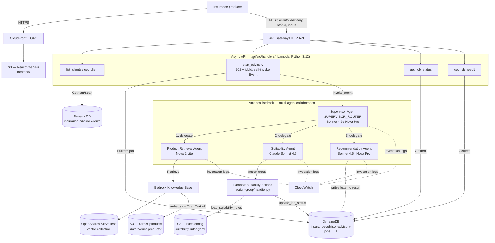

# Architecture — Agentic Insurance Advisor

The Agentic Insurance Advisor is a **Bedrock multi-agent collaboration**: a supervisor agent (`agentCollaboration: SUPERVISOR_ROUTER`) orchestrates three specialists in sequence — **Product Retrieval**, **Suitability Analysis**, and **Recommendation Letter** — and returns one consolidated advisory package. The whole thing runs in your own AWS account: a React SPA on CloudFront talks to an async Lambda + API Gateway REST API, which invokes the supervisor through `bedrock-agent-runtime`. Retrieval is grounded in a Bedrock Knowledge Base over the carrier's product documents; the suitability check is an action-group Lambda that loads eight externalized rules from a YAML file in S3. The output is a draft for a licensed producer to review, edit, and own — never autonomous advice.

## Stack diagram

Provisioning order: `infrastructure/deploy.sh` (CloudFormation — S3, DynamoDB, API Gateway, CloudFront/OAC, IAM) → `data/seed-data.sh` (client profiles, rules YAML, carrier docs) → `agents/setup-agents.sh` + `agents/provision-agents.sh` (action-group Lambda, four agents, KB + action-group attachment, collaborator wiring, aliases) → `api/deploy-api.sh` (five handlers, supervisor agent ID/alias into `start-advisory` env) → `frontend/deploy-frontend.sh` (Vite build → S3 → CloudFront).

## Component responsibilities

| Component | Responsibility | You customize |
|---|---|---|
| React SPA (`frontend/`) | Client selector, advisory-type picker, progress tracker, tabbed results (Products / Suitability / Letter / Full Package), letter export | Branding, layout, auth |
| API Gateway HTTP API | Public REST surface (CORS open in the reference) | Custom domain, authorizer |
| `start_advisory.py` | Creates the job (`202 + jobId`), self-invokes via `InvocationType=Event`, calls `invoke_agent` on the supervisor, writes the result to DynamoDB | Timeout/retry, job schema |
| `list_clients` / `get_client` | Read client profiles from the `clients` table | Map to CRM/policy-admin |
| `get_job_status` / `get_job_result` | Poll job state and fetch the consolidated package | — |
| Supervisor agent (`agents/supervisor/`) | Routes to the three specialists in order, passes full client context, returns each sub-agent's output verbatim | Orchestration instruction |
| Product Retrieval agent (`agents/product-retrieval/`) | RAG over the carrier KB; returns ranked products with citations and eligibility checks | System prompt, KB ID |
| Suitability agent (`agents/suitability/`) | Loads the eight rules via the action group, scores each product, returns per-rule pass/fail + SUITABLE/UNSUITABLE/CONDITIONAL | System prompt |
| Action-group Lambda (`suitability/action-group/handler.py`) | `load_suitability_rules` (S3 YAML), `update_job_status` (DynamoDB) — the only tools any agent calls | Env (rules bucket/key, jobs table) |
| Recommendation agent (`agents/recommendation/`) | Stateless letter generation with the fixed disclosure block | Letter structure, disclosure wording |
| Bedrock Knowledge Base + OpenSearch Serverless | Vector index over carrier product documents; Titan Text v2 embeddings | Product catalog, chunking |
| DynamoDB (`clients`, `advisory-jobs`) | Client profiles; async job state + results (TTL on jobs) | Schema, retention |
| IAM (4 roles) | Least-privilege roles for the agent, action group, KB, and API Lambdas | Account/region/naming |

## Design decisions (summary)

Full rationale (AD1…AD12) is in [`build-spec/architecture-decisions.md`](../build-spec/architecture-decisions.md). Highlights: a supervisor-router topology with three single-responsibility specialists (not one mega-prompt); suitability rules externalized to YAML in S3 so a threshold change needs no code change; every verdict cites its rule ID; every letter carries the mandatory disclosure block; an async job API because a multi-agent run takes 1–3 minutes; and a per-agent model mix (Sonnet 4.5 for reasoning, Nova 2 Lite for RAG, Nova Pro optional for speed).

## Data flow — advisory run (happy path)

1. The producer selects a client and an advisory type in the SPA and clicks **Start Advisory Workflow**.
2. The SPA calls `POST` advisory; `start_advisory.py` writes a job row to the `advisory-jobs` table and returns **`202 + jobId`** immediately.
3. The handler **self-invokes** asynchronously (`InvocationType=Event`) so the long-running agent work happens off the request path.
4. The async invocation calls `bedrock-agent-runtime.invoke_agent` on the **supervisor alias** with the full client profile.
5. **Supervisor → Product Retrieval:** the retrieval agent runs `Retrieve` against the Knowledge Base and returns 3–5 ranked carrier products with citations and eligibility checks.
6. **Supervisor → Suitability:** the suitability agent calls `load_suitability_rules` (action-group Lambda → S3 YAML), scores each product against SUIT-01…SUIT-08, and returns a per-rule pass/fail plus an overall SUITABLE / UNSUITABLE / CONDITIONAL verdict citing rule IDs.
7. **Supervisor → Recommendation:** the recommendation agent drafts the client-facing letter (client summary, products considered, recommendation + rationale, suitability justification, the disclosure block, next steps).
8. The action-group Lambda calls `update_job_status` at each stage (`retrieval_complete` → `analysis_complete` → `complete`), writing partial results to the job row.
9. The SPA polls `get_job_status`; once `complete`, it fetches `get_job_result` and renders the four tabs, with letter export to markdown.

## Data flow — partial-results / failure path

- The supervisor instruction directs it to **report failures clearly and return whatever partial results are available** if a sub-agent fails or times out — e.g. retrieved products and suitability verdicts even if the letter step fails. The job row holds whatever stages completed, so the producer never gets a blank result.
- Advisory runs are **async with a polling model**, so a slow multi-agent pass (1–3 min) never blocks the request; the job row carries `status` through its transitions and the jobs table has a **TTL** so stale jobs expire.

## Audit trail

- Every suitability verdict is **decomposable**: a per-rule pass/fail with reasoning and the cited rule ID (SUIT-01…SUIT-08), not a single opaque score. UNSUITABLE on any rule makes the product UNSUITABLE overall.
- The `advisory-jobs` row retains the retrieved products (with KB citations), the per-product suitability assessment, and the generated letter — the full reasoning chain behind a recommendation.
- Bedrock agent invocation logs (supervisor + sub-agents) and Lambda logs land in **CloudWatch**.

## What's NOT in this architecture (intentionally)

- **No autonomous advice.** The package is a draft for a licensed producer to review, edit, and own. Nothing binds or sends a recommendation without a human.
- **No authentication layer.** The reference API Gateway has CORS open and no authorizer; a production deployment must add auth in front of the API (flag during the build).
- **No CRM / policy-admin integration.** Client profiles are seeded into DynamoDB from `data/client-profiles/clients.json`; wiring to your system of record is your own.
- **No carrier rate-quoting engine.** Premiums come from the indexed product documents, not a live illustration/quoting system; integrating one is a follow-on.
- **Manual Bedrock agent creation step.** `setup-agents.sh` deploys the Lambda but multi-agent collaboration setup is finished via `provision-agents.sh` / the console — the agents aren't pure CloudFormation.
