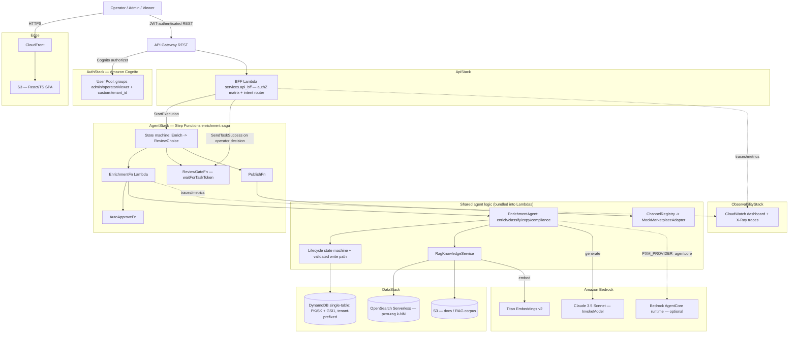

# Architecture — Agentic PXM Platform

The Agentic PXM Platform is a **Custom IaC** build: six AWS CDK stacks that deploy an autonomous product-onboarding agent end-to-end in your account. Rather than one monolithic model call, a single `EnrichmentAgent` runs four ordered stages — **enrich → classify → copy → compliance check** — wrapped in an **AWS Step Functions saga** with retries and a **human-in-the-loop review gate**. Clean SKUs auto-approve and publish; anything with a compliance blocker pauses for an operator. The agent reasons over **Bedrock** (Claude 3.5 Sonnet + Titan embeddings) and grounds itself with **RAG over OpenSearch Serverless**; state lives in a **DynamoDB single table**; a **React SPA on S3 + CloudFront** behind **API Gateway + Cognito** is the operator surface.

## Stack diagram

Deploy path: `cdk deploy --all` (or `./deploy.sh`) provisions all six stacks, then a seed script loads synthetic master data + the RAG corpus and a demo Cognito user is created. All dev resources use `RemovalPolicy.DESTROY` for clean teardown.

## Component responsibilities

| Component | Responsibility | You customize |
|---|---|---|
| React/TS SPA (`frontend/`) | Ingest form, product list/detail, review queue, chat console | Branding, layout |
| API Gateway + Cognito authorizer | JWT validation, single REST surface | Domain, custom auth flows |
| BFF Lambda (`services/api_bff/`) | Maps JWT claims → `TenantContext`, enforces the role authZ matrix, routes chat intents, starts runs / resumes the HITL gate | authZ matrix (rarely) |
| `EnrichmentAgent` (`services/agent/enrichment_agent.py`) | The four stages: normalize attributes → RAG-classify → generate copy → deterministic compliance check | Stage logic for the product domain |
| Step Functions saga (`infra/stacks/agent_stack.py`) | Sequences the run with backoff retries; `waitForTaskToken` HITL gate (3-day timeout); auto-approve vs. review choice | Stage decomposition, timeouts |
| `RagKnowledgeService` (`services/agent/rag.py`) | k-NN retrieval over OpenSearch Serverless; in-memory cosine fallback for local | Corpus, k, source filters |
| `MasterDataService` + lifecycle (`shared/`) | Single validated write path; tenant-scoped reads; product status state machine | SKU validation, lifecycle |
| Channel adapters (`services/review_channel/channel.py`) | `map → validate → publish`; `MockMarketplaceAdapter` returns a deterministic listing id | Replace with real channels |
| `LLMProvider` (`shared/providers.py`) | Bedrock / AgentCore / deterministic fake, env-selected | Model IDs, provider choice |
| DynamoDB single table + OpenSearch + S3 (DataStack) | Tenant-prefixed state, RAG vectors, docs/corpus | Table/collection naming, region |
| Cognito (AuthStack) | Pool-based multi-tenancy, admin/operator/viewer groups | Groups, password policy, IdP |
| CloudWatch + X-Ray (ObservabilityStack) | Invocation/error/duration dashboards, distributed traces | Alarms, retention |

## Design decisions (summary)

The full rationale (AD1–AD10) is in [`build-spec/architecture-decisions.md`](../build-spec/architecture-decisions.md). Highlights: a Step Functions saga with a `waitForTaskToken` HITL gate (high-impact actions stay under operator control); a **deterministic, cited compliance check** (the model enriches, code decides the blocker); a **pluggable `LLMProvider`** so the same code runs offline and on Bedrock/AgentCore; **pool-based multi-tenancy** with a validated single write path; and a **lifecycle state machine** as the single source of truth for status, hardened with property-based tests.

## Data flow — happy path (clean SKU, live Bedrock)

1. An operator/admin ingests a sparse `ProductDraft` via the SPA → `POST` through API Gateway → BFF creates a `Product` in `DRAFT`.
2. The BFF calls `start_run`, which starts the Step Functions execution (`draft → enriching`).
3. **Enrich:** `EnrichmentFn` runs `EnrichmentAgent.run_enrichment` — normalize attributes, RAG-classify against the taxonomy, generate title + short/long copy from brand guidelines, then run the compliance check for each target market.
4. The compliance check finds **no blocker**, so `needs_review = false`.
5. The saga's `ReviewChoice` routes to **AutoApprove** (`enriching → approved`).
6. For a clean product the operator (or the auto-publish wiring) publishes via the channel adapter; the `MockMarketplaceAdapter` validates required fields and returns a `MOCK-<hash>` listing id (`approved → published`).
7. Every transition is written through the validated lifecycle and logged with the run's correlation id; X-Ray traces and CloudWatch metrics capture the run.

## Data flow — HITL path (compliance blocker)

1. Same ingest + enrich as above, but a target-market regulation matches a **restricted substance** or **prohibited claim** in the product (e.g. "lead" for `US-CPSC-LEAD`, "cures cancer" for `US-FTC-CLAIMS`).
2. The compliance stage emits a `BLOCKER` `Finding` citing the `reg_id` + `citation_url`; `needs_review = true`.
3. `ReviewChoice` routes to the **ReviewGate** Lambda, invoked via `waitForTaskToken`. It transitions the product to `NEEDS_REVIEW`, persists a `ReviewItem` (with the task token + findings), and the saga **pauses** (up to 3 days).
4. An operator opens the review queue, sees the cited findings, and decides. The BFF calls `SendTaskSuccess` with the decision.
5. **Approve →** `Publish` runs (`needs_review → approved`, then publish to channel). **Reject →** `needs_review → rejected`. A rejected product can be resubmitted to `draft`.

## Local / offline mode

The same code runs **without AWS**: with `PXM_PROVIDER=fake` and no `PXM_TABLE`/`PXM_OPENSEARCH_ENDPOINT`/`PXM_STATE_MACHINE_ARN` set, the platform uses a deterministic `FakeProvider`, an in-memory repository, an in-memory cosine vector index, and the in-process `LocalOrchestrator` (which mirrors the saga including the PAUSED_REVIEW pause). `python -m services.demo.run_local_demo` drives the full flow over the five fixture SKUs, and the backend `pytest` + Hypothesis suite runs with zero credentials.

## Audit trail

- Each run creates an `EnrichmentRun` (run id, current stage, correlation id, timestamps).
- Every status change goes through the validated lifecycle and emits a `product.transition` event (from-status, event, to-status).
- Compliance `Finding`s persist on the product with `reg_id`, severity, message, and `citation_url`, so any verdict decomposes into the exact regulation that triggered it.
- Lambdas run with X-Ray active tracing; `log_event` carries the correlation id through CloudWatch; the dashboard tracks invocations, errors, and p95 duration.

## What's NOT in this architecture (intentionally)

- **No fully autonomous publish of blockers** — compliance blockers and channel publish stay behind the HITL gate.
- **No LLM-owned compliance verdict** — the blocker decision is deterministic rule matching against the regulation corpus.
- **No real channel integrations shipped** — `MockMarketplaceAdapter` is a placeholder you replace with your marketplaces.
- **No production master-data system** — the kit seeds synthetic `products.json` / `suppliers.json` / `regulations.json` / `corpus.json`; you wire your own master data.
- **Dev removal policies** — all resources deploy with `RemovalPolicy.DESTROY`; a production deployment must harden retention, the OpenSearch network policy (currently `AllowFromPublic`), and alarms.
