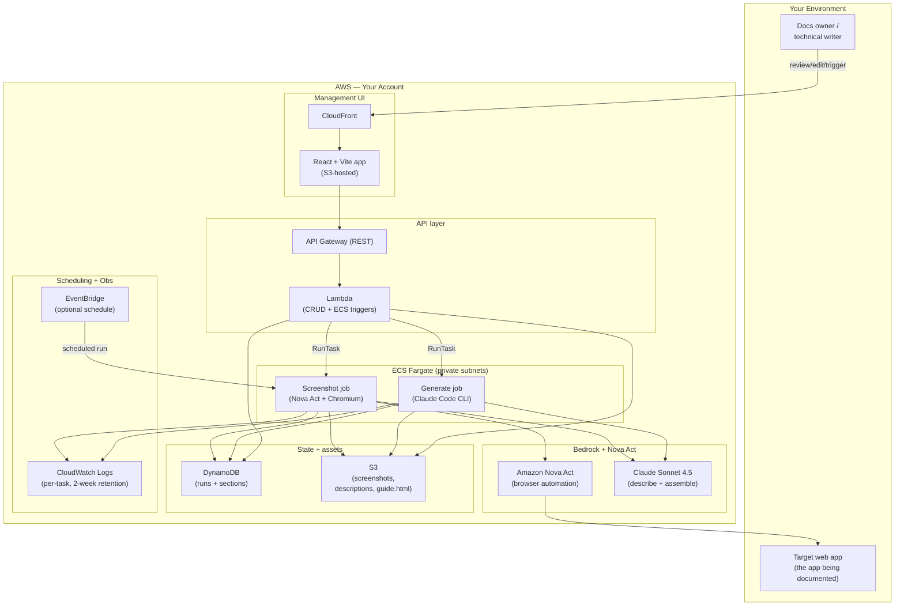

# Reference Architecture — Automated Docs Generator

## Overview

An event-driven pipeline that documents a web application. A management UI (or an EventBridge schedule) triggers a screenshot run; an ECS Fargate task drives the app with Amazon Nova Act, captures each screen, and has Claude describe it; a human reviews and edits the captured sections; a second Fargate task runs the Claude Code CLI to assemble a polished HTML user guide. State lives in DynamoDB; assets and the finished guide live in S3. Not an AgentCore harness — a small custom-IaC application provisioned with CDK.

## Architecture diagram

## Component responsibilities

| Component | Responsibility | You customize |
|---|---|---|
| React + Vite UI (CloudFront/S3) | Runs list with live status, section review/edit, screenshot replace, generate / regenerate-with-feedback | Branding, title/header text |
| Lambda API (API Gateway) | Runs/sections CRUD, presigned S3 upload URLs, ECS `RunTask` triggers for both jobs, presigned guide URL | Presigned URL expiry; routing is generic |
| Screenshot job (ECS Fargate) | Drives the app with Nova Act, captures a PNG per screen, sends each to Claude, writes S3 + DynamoDB | All `step_*` functions, `APP_URL`, credentials, `PRODUCT_CONTEXT`, blocked domains |
| Generate job (ECS Fargate) | Downloads reviewed sections, runs Claude Code CLI to assemble HTML from template + feature context, uploads to S3 | `feature_context.txt`, `template.html`, prompts in `generate.py` |
| Nova Act | AI browser automation — executes natural-language navigation instructions in headless Chromium | Workflow definition name; instruction granularity |
| Bedrock (Claude Sonnet 4.5) | Per-screenshot description + HTML guide assembly via Claude Code CLI | Model version, tone/structure of prompts |
| DynamoDB (runs + sections) | Run lifecycle state and per-section metadata | Table names |
| S3 | Screenshots, descriptions, generated guide HTML; hosts the frontend | Bucket names, CORS |
| EventBridge | Optional scheduled re-capture (default weekly) | Cron schedule, or remove |
| CloudWatch | Per-task logs, run/section status visibility | Retention window |

## Design decisions (summary)

Full rationale in [`build-spec/architecture-decisions.md`](../build-spec/architecture-decisions.md). Highlights: two separate Fargate jobs (capture vs. generate) so they scale and fail independently; Nova Act for browser automation instead of brittle selectors; Claude Code CLI on the Bedrock backend (IAM, no API key) for HTML assembly; a single CRUD Lambda for simplicity; DynamoDB + S3 over a relational store; human-in-the-loop review between capture and generate.

## Data flow — happy path

1. **Trigger** — A docs owner clicks "Trigger Screenshot Run" in the UI (supplying app credentials), or EventBridge fires on schedule. The Lambda creates a run record (`status: created`) and calls `ecs:RunTask` on the screenshot task definition with `RUN_ID` + credentials as container overrides.
2. **Run starts** — The screenshot job sets the run `status: running` and launches headless Chromium under Nova Act, starting at `APP_URL`. Third-party/ad domains are blocked to prevent SSL errors and stray navigation.
3. **Login** — A `step_login` workflow logs into the app with the supplied credentials.
4. **Walk + capture** — Each `step_*` function calls `ensure_on_app` (re-navigates if the browser drifted), uses `safe_act` for each interaction, and `safe_capture` for each screen. `safe_capture` saves a PNG to S3, sends it to Claude for a description, writes the description to S3, and writes a section record to DynamoDB.
5. **Complete** — When the workflow finishes (or the 60-minute timeout fires, saving partial results), the job sets `status: completed` with `sectionCount` (and `timedOut: true` if applicable).
6. **Review** — The UI auto-refreshes every ~8s. The docs owner opens the run, reviews each section, edits AI descriptions inline, and replaces any screenshot via a presigned S3 upload.
7. **Generate** — The user clicks "Generate Guide." The Lambda sets `status: generating` and calls `ecs:RunTask` on the generate task definition.
8. **Assemble** — The generate job downloads section metadata (DynamoDB) + screenshots (S3), prepares a workspace with `template.html` + `feature_context.txt` + a `sections.json` manifest, and runs the Claude Code CLI (Bedrock backend) to populate the template's `<!-- SIDEBAR_NAV -->` and `<!-- SECTIONS -->` placeholders.
9. **Publish** — The job uploads `user_guide.html` to S3 and sets `status: generated`.
10. **View** — The user clicks "View Guide" / "Download HTML"; the Lambda returns a presigned URL to the S3 object.

## Data flow — alternate paths

- **Regenerate with feedback** — The user supplies revision instructions; the generate job runs with a feedback prompt that revises the existing guide instead of building fresh.
- **Timeout** — If the screenshot job hits its wall-clock limit, it persists everything captured so far and marks the run `completed, timedOut: true`. Partial guides are valid.
- **Error** — Any unrecoverable failure sets `status: error` from the current state; the UI surfaces it and the user can start a new run.
- **Manual / empty run** — "New Empty Run" creates a run record the user can populate by uploading screenshots manually, bypassing Nova Act.

## Audit trail

- **DynamoDB** is the source of truth for run lifecycle: `created → running → completed → generating → generated` (or `error`), with `sectionCount`, `timedOut`, and the generated `guideKey`.
- **CloudWatch Logs** capture each ECS task's execution, prefixed by container name (`screenshot`, `generate`), with two-week retention. ECS console shows task exit codes and stop reasons.
- **S3** retains every screenshot, description, and generated guide under the run's key prefix, so any published guide can be traced back to its source captures.

## What's NOT in this architecture (intentionally)

- **No auto-publish.** A human reviews captured sections before a guide is generated. The kit produces an HTML file; it does not push to a docs site or CMS.
- **No third-party site crawling.** It documents your own app, with credentials you supply.
- **No relational database.** Run/section state is small and key-addressed; DynamoDB + S3 suffice.
- **No multi-tenant control plane.** One deployment documents one app (or a few via per-run URLs); it is not a SaaS docs platform.
- **No PHI/PII handling guarantees.** If the app's screens contain sensitive data, you scope the workflow away from those screens — the kit does not redact captured screenshots.

## Scaling & cost considerations

- **Concurrency:** Runs are independent Fargate tasks; multiple can run at once. Steady state is a handful of runs per week.
- **Task sizing:** Both jobs use 4096 MiB / 2048 CPU — the headless browser (screenshot) and the Node-based Claude Code CLI (generate) are memory-hungry.
- **Cost drivers:** NAT Gateway (~$32/mo, the dominant fixed cost) + per-run ECS Fargate (~$2–4 screenshot, ~$1–2 generate) + Bedrock (~$3–8/run for ~50 screenshots' analysis + generation) + Nova Act (preview pricing, variable). S3/DynamoDB/Lambda/CloudFront are <$1/mo each at low volume. ~$40–50/mo on a weekly schedule. Consider VPC endpoints or a NAT instance to cut the NAT cost.
- **Timeout:** 60-minute default per screenshot job; reduce step count or split runs for very large apps.
