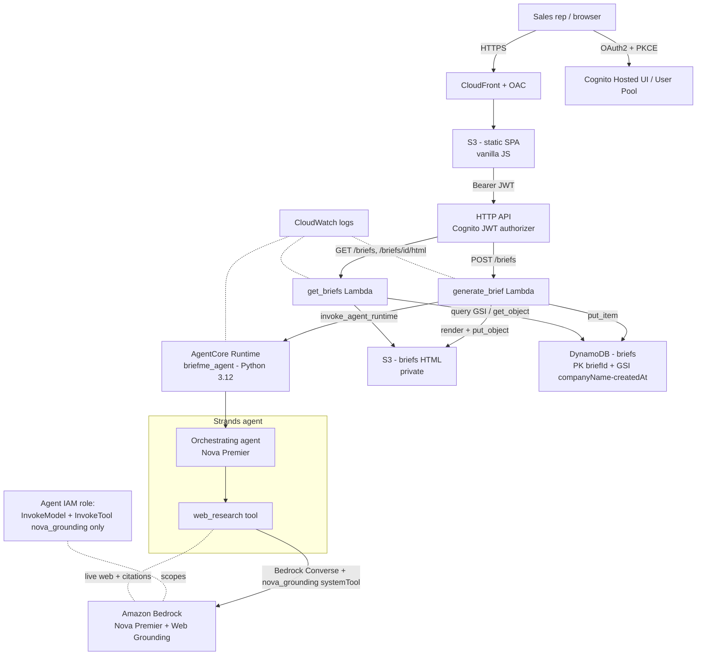

# Architecture — BriefMe Sales Brief Generator

BriefMe is a **serverless single-agent app**. A vanilla-JS SPA behind Cognito calls an HTTP API; a Lambda invokes one **AgentCore-hosted Strands agent** on **Amazon Nova Premier** that does cited web research via **Nova Web Grounding**, returns a structured JSON brief, and the Lambda renders it as a self-contained HTML slideshow that's stored and served back. The entire stack — agent, API, frontend, auth, storage — is one AWS CDK (TypeScript) stack deployed with a single `cdk deploy`, with no container build (AgentCore direct code deployment).

## Stack diagram

Deploy path: `cd briefme-infra && npx cdk deploy` packages `briefme-agent/` (via `AgentRuntimeArtifact.fromCodeAsset`) and `briefme-api/` (via `lambda.Code.fromAsset`), generates the frontend `config.js` with live endpoints, and uploads the SPA to the frontend bucket. No Docker, no ECR.

## Component responsibilities

| Component | Responsibility | You customize |
|---|---|---|
| SPA (`briefme-frontend/`) | Search form, slideshow viewer, brief-history panel; Cognito Hosted UI auth flow | Branding, layout, UX |
| CloudFront + S3 (frontend) | Serve the static SPA over HTTPS via OAC; SPA error-routing to `index.html` | — |
| Cognito (User Pool + Hosted UI) | Authenticate reps; issue JWTs the API authorizer validates | Self-signup, allowed domains, federation, callback URLs |
| HTTP API + JWT authorizer | Route `/briefs` (POST/GET) and `/briefs/{id}/html` (GET); enforce auth | — |
| `generate_brief` Lambda | Validate input, invoke the runtime, render HTML, persist to S3 + DynamoDB | Timeout/memory if research scope grows |
| AgentCore Runtime (`briefme-agent`) | Host the Strands agent; receive `{company_name, website_url}`, return the brief dict | — (it's the runtime; logic lives in the agent) |
| Strands agent + `web_research` tool | Decide research topics, call Web Grounding per topic, capture citations, synthesize structured JSON | `SYSTEM_PROMPT`, topic queries, brief schema |
| `html_renderer.py` | Render the brief dict into a navigable, self-contained HTML slideshow incl. Sources slide | Slides, styling, fields shown |
| `get_briefs` Lambda | List briefs by company (GSI query) and return stored HTML | — |
| DynamoDB + S3 (briefs) | Persist brief metadata (with company GSI) and rendered HTML | Retention policy |
| Agent IAM role | Least-privilege Bedrock invoke + `nova_grounding` tool | Account, region, model id |

## Design decisions (summary)

Full rationale is in [`build-spec/architecture-decisions.md`](../build-spec/architecture-decisions.md). Highlights: one orchestrating agent with a single grounding tool (not a multi-agent pipeline); Web Grounding via the Converse `systemTool` on Nova Premier; AgentCore **direct code deployment** rather than a container (chosen mid-build to drop the Dockerfile/ECR step); a deterministic JSON-extraction + fallback so the API never 500s on a stray model response; HTTP API + Cognito JWT for auth; and DynamoDB-metadata + S3-HTML split for cheap, searchable persistence.

## Data flow — happy path

1. A rep signs in through the Cognito Hosted UI (OAuth2 authorization-code + PKCE); the SPA holds the JWT.
2. The rep submits a company name (and optional URL); the SPA calls `POST /briefs` with the Bearer token.
3. The HTTP API validates the JWT via the Cognito authorizer and routes to `generate_brief`.
4. `generate_brief` calls `bedrock-agentcore.invoke_agent_runtime` with `{company_name, website_url}` and a 33+ char session id.
5. The AgentCore Runtime starts the Strands agent; the agent's prompt instructs it to research overview, products/services, recent news, and stakeholders.
6. For each topic the agent calls `web_research`, which invokes the Bedrock **Converse** API with the `nova_grounding` system tool; grounded text comes back with **source citations**, which are accumulated.
7. The agent synthesizes a single structured JSON brief (with the citation list appended) and returns it through the runtime.
8. `generate_brief` parses the brief, renders it to a self-contained HTML slideshow (`html_renderer.py`), and `put_object`s the HTML to the private briefs S3 bucket.
9. It writes brief metadata (`briefId`, `companyName`, `companyNameLower`, `createdAt`, `s3Key`, `summary`) to DynamoDB.
10. It returns the brief payload + rendered HTML to the SPA, which displays the slideshow; the rep can navigate slides and open the Sources slide to verify citations.
11. Later, the rep can search by company — `get_briefs` queries the GSI (newest first) and fetches stored HTML via `/briefs/{briefId}/html`.

## Data flow — alternate / fallback paths

- **Malformed model output:** if the agent's text isn't valid JSON, `_extract_json` tries to recover an embedded object; if that fails, the agent returns a fallback brief (raw text as overview, empty lists) so the API still renders something instead of erroring.
- **Agent invocation failure:** `generate_brief` catches runtime errors and returns a `502` with a structured error; rendering/persistence failures return `500`. No silent failures.
- **Thinly-covered company:** Web Grounding may return little; the brief uses empty lists / brief notes per the prompt rather than fabricating.

## Audit trail

- Every brief's **citations** (source URL + domain) are captured from Web Grounding and persisted in the rendered HTML (Sources slide) — claims are traceable to sources.
- DynamoDB records `briefId`, company, `createdAt`, and `s3Key` for every generated brief.
- Lambda and AgentCore Runtime execution logs land in **CloudWatch**.

## What's NOT in this architecture (intentionally)

- **No outbound actions** — BriefMe produces a brief; it does not email, schedule, or write to CRM.
- **No private-data grounding** — research is over the **public web** via Web Grounding; there's no RAG over your internal documents.
- **No multi-agent pipeline** — a single orchestrating agent with one research tool, by design.
- **No streaming to the UI** — the brief is returned as a batch response (the agent Lambda has a 120 s budget); the slideshow renders once complete.
- **Cross-account or multi-tenant sharing** — one single-tenant deployment per organization in your own account/region.
