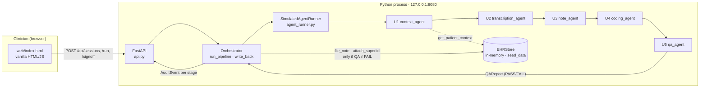
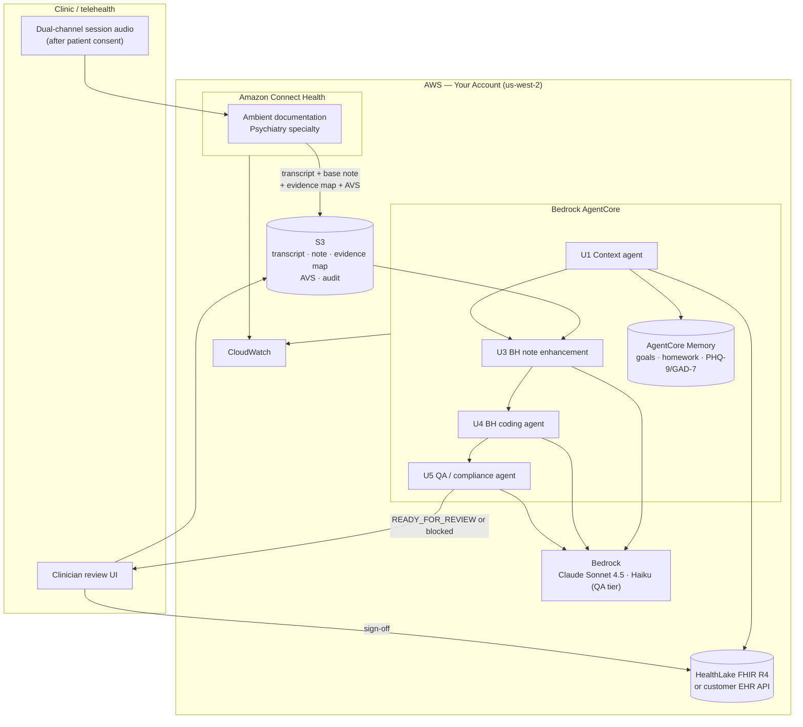

# Architecture — Clinical Documentation Agent

This kit is a **staged, gated pipeline** rather than a single conversational agent. Five specialized stages run in fixed order, each emitting an audit event, and a blocking QA stage decides whether the result may be presented for clinician sign-off. The pattern is the same whether the stages are the shipped deterministic Python handlers or Bedrock-backed agents: the `AgentRunner` interface is the seam, and the orchestrator, API, and UI do not change when the backend does.

Two architectures are documented below. The **prototype** is the deterministic, offline-runnable first build the spec calls for. The **target** is the hybrid Amazon Connect Health + Bedrock AgentCore design you build toward.

## Prototype architecture (first build)

No AWS service is invoked. The three agents that call a model in production (U3 note, U4 coding, U5 QA) are rule-based stand-ins that encode the same contracts the production prompts must satisfy.

## Target architecture (hybrid, recommended)

Connect Health handles the hard, HIPAA-eligible parts — real-time dual-channel transcription, speaker diarization, base clinical note, evidence mapping, after-visit summary — and writes them to S3. The AgentCore layer adds what a general ambient scribe does not: BH-specific pre-session context, treatment-plan progress, time-banded psychotherapy coding with credential scope, and the blocking QA gate.

## Component responsibilities

| Component | Responsibility | You customize |
|---|---|---|
| **Clinician UI** (`web/index.html`) | Lists catalog, creates a session from a transcript, runs the pipeline, renders note + evidence map + codes + QA report + audit trail, submits sign-off. | Branding; embedding into the EHR front end; which fields are shown pre-sign |
| **FastAPI service** (`api.py`) | Session lifecycle routes; 20,000-char transcript cap (413); 409 if sign-off attempted before READY_FOR_REVIEW; 422 if QA is FAIL. | Auth (none in prototype); rate limits; TLS termination |
| **Orchestrator** (`orchestrator.py`) | Runs U1→U5 in order via `_step`, logs an `AuditEvent` per stage, re-raises on failure after logging a SYSTEM event. `write_back` refuses on QA FAIL, else files note + superbill and sets SIGNED. | Nothing — this is the kit's spine |
| **AgentRunner** (`agent_runner.py`) | Backend abstraction. `SimulatedAgentRunner` ships; `BedrockAgentRunner` is the production implementation. | Implement the Bedrock runner; keep `AgentResult` shape |
| **U1 Context agent** | Loads treatment goals, last-session summary, homework, PHQ-9/GAD-7 trend, remaining authorized sessions; selects template; raises `auth_alert` when `sessions_remaining < 3`. | Template routing; which context fields; alert threshold |
| **U2 Transcription agent** | Prototype: parses `CLINICIAN:`/`PATIENT:` free text into diarized utterances. Target: reads Connect Health transcript from S3. | ASR source; speaker-label mapping |
| **U3 Note agent** | Fills `TEMPLATE_SECTIONS` from transcript + context; builds `evidence_map`; leaves Risk Assessment empty if no SI/HI screening is in the transcript. | Templates; section wording; evidence granularity |
| **U4 Coding agent** | ICD-10 carry-forward; CPT by duration band / crisis / E&M; add-ons 90785/90863; modifier 95; prescriber-credential scope check. | Bands per payer contract; credential sets; payer-specific add-ons |
| **U5 QA agent** | Seven checks (sections, risk_assessment, time_cpt, diagnosis, hallucination, credential, measurement); any FAIL blocks sign-off. | Which checks are FAIL vs WARN; `clinical_vocab` allowlist |
| **EHRStore** (`ehr_store.py`) | Prototype: in-memory dict seeded from `seed_data.py`. Target: your EHR API or HealthLake. | The adapter itself; keep `get_patient_context`, `file_note`, `attach_superbill` |
| **Amazon Connect Health** (target) | Ambient documentation: dual-channel transcription, diarization, base note, evidence map, AVS → S3. | Specialty, note template, consent flow |
| **Bedrock / AgentCore** (target) | Hosts U1/U3/U4/U5 as Strands agents on Claude Sonnet 4.5 (Haiku for QA tier); AgentCore Memory for context. | Prompts (ported from handler rules), model tiering, caching |

## Design decisions (summary)

Full rationale in [`build-spec/architecture-decisions.md`](../build-spec/architecture-decisions.md).

- **Blocking QA, not advisory** — a failed mandatory check prevents sign-off (AD3).
- **Evidence map on every claim** — clinician and compliance can trace any sentence to an utterance (AD4).
- **Deterministic coding and credential rules, even after the model swap** — the model drafts; rules decide codes (AD5, AD6).
- **`AgentRunner` seam** — simulation and production share orchestrator, API, UI, and tests (AD2).
- **Hybrid Connect Health + AgentCore** over all-custom — managed HIPAA-eligible ASR and base note, custom BH layer on top (AD7).
- **Direct EHR API, no HL7/FHIR interface engine** — you control both sides (AD9).

## Data flow — happy path (CBT, 53 minutes, in-person, LCSW)

1. Clinician creates a session (`POST /api/sessions`) with `patient_id=PT-1001`, `session_type=cbt`, a transcript, `duration_min=53`, `provider_credential=LCSW`.
2. `POST /api/sessions/{sid}/run` → `Orchestrator.run_pipeline`.
3. **U1** loads Alex Rivera's context (goals, last summary, homework, PHQ-9 trend, `sessions_remaining=6`), selects `CBT Session`. Audit event logged.
4. **U2** diarizes the transcript: N clinician / M patient utterances, mean ASR confidence reported. Audit event.
5. **U3** fills Subjective, Interventions, Risk Assessment (from the utterance where the clinician asked about SI/HI), Plan, etc.; `evidence_map` records claim → utterance index. Audit event.
6. **U4** carries forward `F33.1`; 53 min → `90837`; no modifier (in-person); `credential_scope_ok=True`. Audit event.
7. **U5** runs seven checks: sections PASS, risk_assessment PASS, time_cpt PASS, diagnosis PASS, hallucination PASS, credential PASS, measurement PASS/WARN. `overall=PASS`. Audit event.
8. Orchestrator builds the after-visit summary; status → `READY_FOR_REVIEW`.
9. Clinician reviews note, codes, evidence map, QA report in the UI; `POST /signoff`.
10. `write_back` files the note and superbill to `EHRStore`, appends to `write_log`, status → `SIGNED`. In the target, this is the HealthLake/EHR write and an S3 audit object.

## Data flow — blocked path (missing SI/HI screening)

1–4 as above, with a transcript in which the clinician never asked about suicidal or homicidal ideation.
5. **U3** finds no screening utterance → Risk Assessment section is **empty** by design.
6. **U4** codes normally.
7. **U5** `risk_assessment` → FAIL: "No SI/HI screening found in transcript — note cannot be signed." `overall=FAIL`.
8. Status → `READY_FOR_REVIEW` with blocking failures shown. Clinician sees exactly which check failed and why.
9. `POST /signoff` → **422**. `write_back` raises `ValueError("Cannot write back: QA has blocking failures.")`. Nothing reaches the EHR.
10. Remediation is clinical, not technical: the clinician documents the screening (if it happened off-transcript) or schedules follow-up. The pipeline re-runs.

The same shape applies to a credential-scope failure (LCSW + med-management → `99214` flagged) and a CPT-time mismatch.

## Audit trail

Every stage writes an `AuditEvent{ts, stage, actor, summary, detail}` — U1 through U5, then SIGNOFF and WRITE_BACK. In the prototype, timestamps are pinned to a fixed base for reproducibility (NFR2); in production they are real. `GET /api/sessions/{sid}/audit` returns the full list and the UI renders it. In the target, the audit list is persisted to S3 alongside the Connect Health outputs and mirrored to CloudWatch Logs; retention follows your compliance policy (7 years is typical).

The evidence map is part of the audit story: a compliance reviewer can pick any sentence in the signed note and see the transcript utterance that supports it.

## What's NOT in this architecture (intentionally)

- **Autonomous filing.** There is no path from QA PASS to the EHR that skips the clinician. This is decision support with a hard human gate.
- **Model-chosen CPT codes.** Duration bands and credential scope are rules. The model writes the rationale; it does not pick the code.
- **Audio capture inside the kit.** The pipeline begins at the transcript. Connect Health or Transcribe Medical owns audio.
- **A payer rules engine.** The coding rules are a representative BH subset. Payer-specific edits are a customization, not a kit component.
- **Multi-tenancy.** One deployment per organization account.
- **Research de-identification pipeline.** A reasonable follow-on; not part of this kit.

## Deployment topology

Single account, single region (`us-west-2` default for Connect Health availability). Connect Health and Bedrock are HIPAA-eligible services under your BAA. AgentCore agents run in your account; AgentCore Memory, S3, and HealthLake are yours. The clinician UI is served from your existing web tier or embedded in your EHR. No VPC is required for the managed services; if the EHR adapter calls an on-premises API, a VPC with a private connection to that network is your responsibility.
