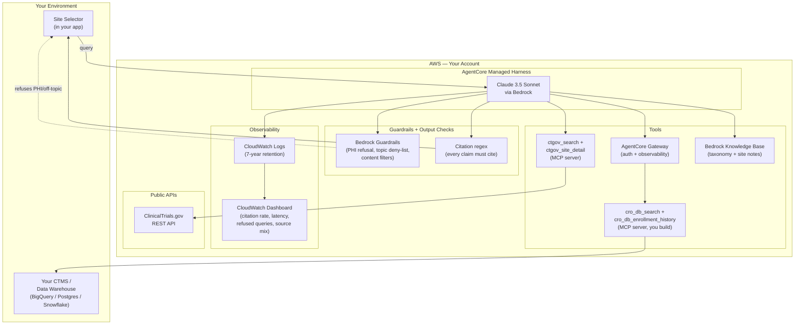

# Reference Architecture — Clinical Trial Site Lookup

## Overview

A site-selection assistant for pharma sponsors and CROs running multi-site trials. Given a natural-language query, the agent searches ClinicalTrials.gov plus your internal CRO database, ranks candidate sites by enrollment performance and capacity, and returns a fully-cited shortlist. Read-only — no PHI in scope.

## Architecture diagram

## Component details

### AgentCore Managed Harness — orchestrator
- **Model:** Claude 3.5 Sonnet on Bedrock (`anthropic.claude-3-5-sonnet-20241022-v2:0`)
- **Role:** Parse natural-language query → resolve therapeutic-area synonyms via KB → search ClinicalTrials.gov → enrich candidates with your CRO data → rank → emit cited shortlist
- **Memory:** Short-term session memory enabled (so users can follow up: "now show me the same trial in the EU"). No long-term memory by default.
- **Why managed-harness:** Value is entirely in prompt + tools + KB + Guardrails. No custom orchestration code. No Lambda action groups.

### ClinicalTrials.gov MCP server — public trial data
- **Source:** Public ClinicalTrials.gov REST API
- **Tools exposed:** `ctgov_search` (filter trials by condition, phase, location, status), `ctgov_site_detail` (PI, location, status for a given facility)
- **Implementation:** Thin REST wrapper. ~50 lines per endpoint. If a published community MCP exists at build time, use it; otherwise your coding agent builds one.
- **Auth:** None — public data.

### Your CRO database MCP server — internal site data
- **Source:** Your CTMS / data warehouse
- **Tools exposed:** `cro_db_search` (find sites by PI / geography / therapeutic area), `cro_db_enrollment_history` (recent enrollment performance for a given site)
- **Implementation:** You build — kit ships an MCP server template; your coding agent fills in the database connection. Behind AgentCore Gateway for auth + observability.
- **Auth:** Your standard service-account credentials, stored in AgentCore Identity Token Vault.

### Knowledge Base — taxonomy + site profiles
- **Source:** Your therapeutic-area taxonomy (synonyms, parent/child relationships) + free-text site profile notes from feasibility analysts
- **Embedding:** Titan Embeddings v2
- **Vector store:** OpenSearch Serverless (default for AgentCore harness KB)
- **Chunking:** 512 tokens with 100 overlap
- **Purpose:** Resolve "NSCLC" ↔ "non-small cell lung cancer" synonyms; surface qualitative site notes that aren't in the structured CRO database

### Guardrails (Layer 1 — Bedrock)
- **PHI refusal:** Block inputs containing patient identifiers, MRN, DOB, name+DOB combinations
- **Topic deny-list:** Block diagnostic claims, dosing recommendations, treatment guidance, patient-matching requests
- **Content filters:** HIGH on sexual / violence / hate (catches anomalies)

### Citation regex (Layer 2 — kit-specific output check)
- Every output is scanned for factual claims (numbers, named entities, dates, status assertions)
- Each must be followed by a citation in one of three formats:
  - `[Source: ClinicalTrials.gov NCT12345678 #facility-7]`
  - `[Source: CRO_DB site_id=XYZ enrollment_history.2024-Q3]`
  - `[Source: KB therapeutic-area-taxonomy.NSCLC.synonyms]`
- Outputs without citations are rejected; the agent retries up to 3 times before returning "cannot answer with available data"

### Observability
- Every query, tool call, and response logged to CloudWatch with structured fields
- 7-year retention by default (clinical-research compliance)
- Custom dashboard tracks: queries/day, citation rate, source mix, p50/p95/p99 latency, refused queries (PHI / off-topic), error rate per tool

## Data flow

1. **Query** — Site selector enters a natural-language query in your app; the app passes it to the AgentCore Harness with the user's identity in the request context
2. **Guardrail (input)** — Bedrock Guardrails check for PHI patterns and off-topic content; refuse before invoking the model if either fires
3. **Parse** — Claude parses the query into structured criteria (therapeutic area, phase, geography, ranking preferences)
4. **Resolve synonyms** — Agent calls `kb_retrieve` to expand the therapeutic-area term into your taxonomy
5. **Search public** — Agent calls `ctgov_search` with the resolved criteria; ClinicalTrials.gov returns matching active trials
6. **Enrich each candidate** — For each candidate site, agent calls `ctgov_site_detail` (public) and `cro_db_enrollment_history` (your CTMS via Gateway)
7. **Rank** — Agent applies your configured ranking weights (enrollment performance / PI track record / geography / activation speed)
8. **Filter blocked sites** — Sites in your blocked list are removed (logged for audit, hidden from output)
9. **Format with citations** — Each claim about each site is cited inline
10. **Citation check** — Output runs through the regex guard; missing citations trigger retry up to 3x
11. **Return** — Structured JSON response to your app
12. **Log** — Full audit trail (query, tool calls, response, citation count, refusals) to CloudWatch with 7-year retention

## Configuration points (you customize)

| What | How |
|---|---|
| Internal CRO database connection | Your coding agent builds the `cro_db_*` MCP servers with your CTMS connection details |
| Therapeutic-area taxonomy | Your clinical operations team uploads taxonomy docs to the KB source S3 bucket |
| Site profile notes | Your feasibility team uploads free-text notes to the same KB bucket (optional) |
| Ranking weights | Edit the harness system prompt or pass weights as a runtime parameter; defaults are 40/30/20/10 (enrollment / PI / geography / activation) |
| Blocked / preferred site lists | You specify a location (S3 / DynamoDB / your own database); the harness reads at query time |
| Geographic and time-zone preferences | Per-program configuration in your portfolio system |

## Scaling considerations

- **Volume:** AgentCore harness handles concurrent invocations natively. Steady state per deployment is ~50–500 queries/day; no provisioning concerns.
- **Cost:** Primary drivers are Bedrock invocations (~$0.05–$0.10 per query) + KB retrieve (~$0.02) + Gateway + MCP tool calls (~$0.03). Estimated $0.10–$0.30 per query end-to-end.
- **Latency:** Target p95 < 8s end-to-end. Multi-tool queries (ClinicalTrials.gov + CRO DB enrichment for ~10 candidate sites) typically complete in 5–7s.
- **ClinicalTrials.gov rate limits:** Public API has a per-IP rate limit. The MCP server caches recent results (TTL 1 hour) to avoid hitting it for repeat queries.
- **Your CRO database load:** Per-query: ~10 enrichment lookups against your CTMS. Most CTMSes handle this comfortably; flag with your data team during the design session if the CTMS is known to be slow.
