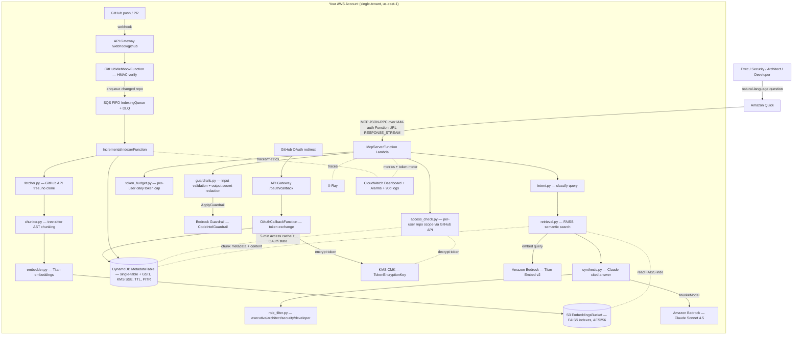

# Architecture — Code Intelligence Agent

The Code Intelligence Agent is an **MCP server packaged as a serverless AWS SAM stack**. Rather than a fine-tuned model, it is a **RAG pipeline**: it ingests a GitHub repo through the GitHub API (no clone), chunks the code AST-aware, embeds it with Bedrock Titan, stores the vectors in a FAISS index on S3, and answers natural-language questions with Claude Sonnet 4.5 — every answer grounded in retrieved chunks and carrying `file:line` citations. Amazon Quick is the front door, talking to an IAM-authenticated Lambda Function URL. GitHub identity is passed through per request, so the agent only ever answers over repos the asking user can already see.

## Stack diagram

Deploy path: `sam build && sam deploy --guided` provisions the whole stack into your account. The MCP Function URL is registered in Quick as a "Connect to any MCP server" target; API Gateway carries only webhook and OAuth traffic, never MCP traffic.

## Component responsibilities

| Component | Source | Responsibility | You customize |
|---|---|---|---|
| MCP server Lambda | `src/mcp/server.py`, `src/handler.py` | JSON-RPC routing, `RESPONSE_STREAM` streaming, dispatch to tool handlers | Rarely |
| MCP tools | `src/mcp/tools.py` | `query_code`, `index_repo`, `get_status`, `connect_github`, `query_dependencies` | Tool surface |
| Intent classifier | `src/query_engine/intent.py` | Classify query (architecture / search / dependency / security / operations / admin / status); LLM call with keyword fallback | Categories + keywords |
| Retrieval | `src/query_engine/retrieval.py` | Titan query embedding → FAISS search per in-scope repo → merge/rank top-10 → resolve chunk metadata+content from DynamoDB | `top_k`, ranking |
| Synthesis | `src/query_engine/synthesis.py` | Claude answer grounded in retrieved chunks, `[file:line-line]` citations, code-as-data grounding rules | Prompt + citation format |
| Role filter | `src/query_engine/role_filter.py` | Shape depth per persona — executive (no code blocks, top-3 citations), architect (file-deduped), security/developer (full) | Personas + detail rules |
| Ingestion | `src/ingestion/{fetcher,chunker,embedder}.py` | GitHub-API file fetch (no clone, rate-limit aware), tree-sitter AST chunking with line fallback, Titan embedding | Chunking rules, languages |
| Incremental indexer | `src/ingestion/incremental*.py` | Re-index changed files from SQS messages | Batch behavior |
| Identity | `src/identity/{tokens,access_check,token_budget,cache}.py` | KMS-encrypted token store, per-user GitHub access check (5-min cache), daily token budget | TTLs, budget |
| Guardrails | `src/guardrails.py` + `CodeIntelGuardrail` | Local input validation + output secret redaction AND Bedrock Guardrail | Policy + regexes |
| Observability | `src/observability/*`, `template.yaml` | X-Ray traces, CloudWatch dashboard, error/DLQ alarms, token meter, 90-day logs | Thresholds, retention |

## Knowledge layer

- **Vector store:** per-repo **FAISS** indexes persisted to the S3 `EmbeddingsBucket`, cached in Lambda `/tmp` to avoid re-downloading on warm invocations (`src/knowledge/vector_store.py`).
- **Metadata + content:** a single **DynamoDB** table (`MetadataTable`) with a `GSI1`, holding repo records, chunk metadata (`file_path`, `start_line`, `end_line`, `symbol_name`, `language`), and chunk content under `CHUNK#<id> / CONTENT`. KMS-encrypted, point-in-time recovery on, TTL enabled for caches.
- **Embeddings:** Titan Embed v2 at **1024 dimensions, normalized** — the same model is used at index time and query time so vectors are comparable.

## Data flow — query path (the common case)

1. A user asks a question in Amazon Quick (e.g. "Which services handle PII?"). Quick calls the MCP Function URL with same-account IAM auth and the user's identity.
2. `query_code` runs the **input guardrail** (`guardrails.py`) — SQL/shell/prompt-injection and path-traversal patterns are rejected before any model call.
3. The **per-user daily token budget** is checked (`token_budget.py`, default 100K/day); over-budget requests are refused.
4. **Intent classification** (`intent.py`) routes the query. `admin`/`status` short-circuit to the relevant handler without an LLM call; everything else uses a cheap Claude classification (max 20 tokens, temperature 0) with a keyword-regex fallback.
5. **Repo scoping** — the metadata store lists the user's repos; `access_check.py` confirms GitHub read access per repo (GitHub API is the source of truth, results cached 5 min in DynamoDB). The query never sees repos the user can't see.
6. **Retrieval** (`retrieval.py`) embeds the query with Titan, searches each in-scope repo's FAISS index, merges and ranks, and loads the top-10 chunks' metadata and content from DynamoDB.
7. **Synthesis** (`synthesis.py`) sends the retrieved chunks to Claude Sonnet 4.5 with a grounding system prompt — code is treated as **data only** (embedded instructions are never followed), and the model must cite `[file:line-line]` for every claim or say it can't answer from the indexed context.
8. **Role filtering** (`role_filter.py`) trims the answer to the asker's persona.
9. The **output guardrail** redacts any secret-shaped strings (GitHub tokens, API keys, hardcoded credentials) before the answer leaves the account.
10. Token usage is metered, the budget is decremented, and the cited answer streams back to Quick.

## Data flow — indexing path

- **First index** (`index_repo`): `fetcher.py` walks the repo tree via the GitHub API (no clone, rate-limit aware), `chunker.py` chunks each file AST-aware (tree-sitter; falls back to 150-line/20-overlap windows when no grammar applies), `embedder.py` embeds chunks with Titan, the FAISS index is written to S3, and chunk metadata lands in DynamoDB. Small repos index in-process inside the Lambda.
- **Auto re-index**: a GitHub `push`/`pull_request` webhook hits API Gateway → `webhook.py` verifies the HMAC signature → enqueues to the **SQS FIFO** `IndexingQueue` → `IncrementalIndexerFunction` re-indexes the changed files. A DLQ (14-day retention, `maxReceiveCount` 3) captures poison messages and raises the `DLQAlarm`.

## Trust boundary and security

- **Single-tenant** in your account and region; the only outbound dependencies are in-region Bedrock and the GitHub API.
- **Identity pass-through:** OAuth tokens are encrypted with a you own KMS CMK and used via a callback pattern so the plaintext token never outlives the API call. Repo access is checked per user, every query.
- **Two guardrail layers:** local regex validation/redaction in code AND the Bedrock `CodeIntelGuardrail` (content filters, PII anonymization, GitHub-token and API-key regexes, profanity list).
- **Least-privilege IAM per Lambda:** the MCP function gets DynamoDB CRUD on its table, S3 CRUD on its bucket, `bedrock:InvokeModel*`, `ApplyGuardrail` on the specific guardrail ARN, and KMS encrypt/decrypt — nothing broader. The OAuth function gets KMS encrypt only; the webhook function gets SQS send only.
- **Cost/DoS controls:** per-user daily token budget and `ReservedConcurrentExecutions: 50` on the MCP function.

## Observability

- **X-Ray** tracing is active on all functions, with subsegments around intent classification, repo scoping, semantic search, and synthesis.
- A **CloudWatch dashboard** renders query latency (p50/p99), token usage (input/output), Lambda errors, and SQS queue + DLQ depth.
- **Alarms:** `HighErrorRateAlarm` (>5 MCP errors over two 5-min periods) and `DLQAlarm` (≥1 message in the indexing DLQ).
- Log groups retain **90 days** (set via `aws logs put-retention-policy` after first deploy).

## What's NOT in this architecture (intentionally)

- **Not a developer IDE copilot** — no code completion, no PR authoring. The agent answers questions; it never modifies a repo.
- **No autonomous actions** — it does not deploy, change infrastructure, or act on findings.
- **Frontier-Agent delegation is roadmap, not shipped** — `SECURITY` and `OPERATIONS` intents are classified, but `src/delegation/` is a stub. Delegating those intents to specialized Bedrock Agents is Phase 2 (see the source `ROADMAP.md`); don't present it as built.
- **No large-repo offload by default** — repos over ~1000 source files can exceed the Lambda 15-minute indexing window; the source documents a Fargate or Step Functions Distributed Map offload as the scale-out pattern.
