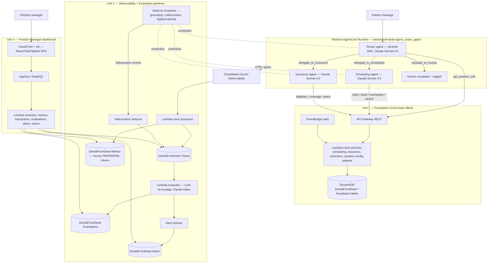

# Architecture — Dental Front-Desk Agent

This kit is a **router + specialist multi-agent system** packaged as four CloudFormation stacks. A patient message hits the **Router agent** on Bedrock AgentCore Runtime; the router classifies intent and either answers a general practice question itself or delegates to the **Scheduling** or **Insurance** specialist agent. Specialists call back-office services (mock by default) over HTTP. Every turn is traced via OTEL, scored by an LLM-as-a-judge evaluation pipeline against four rubrics, and surfaced to practice managers in a React + AppSync dashboard. All three agents run on Claude Sonnet 4.5, constrained by HIPAA-safe-language prompt rules and a Bedrock Guardrail.

## Stack diagram

Deploy path: four CloudFormation stacks — `unit-1-foundation.yaml` (DynamoDB + Lambda mock services + API Gateway + EventBridge), `unit-2-agents.yaml` (agent gateway), `unit-3-pipelines.yaml` (observability + evaluation tables and Lambdas), `unit-4-dashboard.yaml` (AppSync + S3 + CloudFront) — then `scripts/deploy-agent-boto3.py` pushes the router agent to AgentCore Runtime via the `bedrock-agentcore-control` API. Region `us-east-1`.

## Component responsibilities

| Component | Responsibility | You customize |
|---|---|---|
| Router agent (`packages/router-agent`) | Intent classification (SCHEDULING / INSURANCE / GENERAL / ESCALATE / UNCLEAR), delegation, general practice Q&A, frustration detection, escalation | System prompt, intent rules, escalation triggers |
| Scheduling agent (`packages/scheduling-agent`) | Slot search, book / reschedule / cancel, patient appointment lookup; confirms before booking | Prompt, policies (booking horizon, cancellation), tool endpoints |
| Insurance agent (`packages/insurance-agent`) | Eligibility, coverage, accepted-plan lookups; mandatory disclaimer on every coverage answer | Prompt, disclaimer wording, tool endpoints |
| Mock services (`packages/mock-services`) | Scheduling / insurance / reminders / practice-config / patient APIs on Lambda + API Gateway + DynamoDB | Replace with real PMS / insurance integrations or reseed |
| Bedrock Guardrail | Grounding + hallucination checks; blocks/wars unsafe content (`ApplyGuardrail`) | Denied topics, grounding source, thresholds |
| Observability pipeline (`packages/observability`) | OTEL trace processing, hourly latency (P50/P95/P99) + token aggregation, hallucination-event tracking | Aggregation windows, retention |
| Evaluation pipeline (`packages/evaluations`) | LLM-as-a-judge scoring on four rubrics, weighted composite, threshold alerting | Rubrics, weights, alert thresholds |
| Dashboard API (`packages/dashboard-api`) | AppSync GraphQL + Lambda resolvers over the `DentalFrontDesk-*` tables | Queries, auth context |
| Dashboard UI (`packages/dashboard-ui`) | React/Vite/Tailwind/Apollo/Recharts: metrics, transcripts, scores, trends, alerts | Branding, views, tenant scoping |
| AgentCore Runtime + IAM | Hosts the agents; least-privilege `DentalFrontDeskAgentCoreRuntime` role | Account, region, naming |

## Design decisions (summary)

Full rationale is in [`build-spec/architecture-decisions.md`](../build-spec/architecture-decisions.md). Highlights: a router + specialist split (not one mega-prompt) so each capability is scoped and observable; HIPAA-safe language enforced in every prompt plus a Bedrock Guardrail as a second line; a mandatory insurance disclaimer and confirm-before-book rule; multi-tenancy by `tenant_id` partition key; a separate cheaper Haiku judge scoring four rubrics at 100% sampling; and mock services as deliberate stand-ins for your real systems.

## Data flow — scheduling happy path

1. A patient message arrives at the AgentCore Runtime entrypoint with `prompt`, `tenant_id`, optional `patient_id`, and `session_history`.
2. The **Router agent** classifies intent. For "I need to move my cleaning to next week" → SCHEDULING → it calls `delegate_to_scheduling`.
3. The **Scheduling agent** calls `find_available_slots` (and `get_patient_appointments` if rescheduling) against the mock scheduling service via API Gateway, tenant-scoped by `X-Tenant-ID`.
4. It presents 2–3 options, asks one question at a time, and **waits for explicit confirmation** before calling `book_appointment` / `reschedule_appointment`.
5. The tool result (confirmed booking) is relayed back through the router to the patient in HIPAA-safe language ("your appointment", never the procedure name unless the patient raised it).
6. OTEL spans for the turn (tool calls, latency, tokens) flow to CloudWatch and into the **trace processor** (`DentalFrontDesk-Traces`); hourly aggregation updates `DentalFrontDesk-Metrics`.
7. The **evaluation pipeline** scores the interaction transcript on accuracy, HIPAA-safe language, empathy, and policy adherence, writes the composite to `DentalFrontDesk-Evaluations`, and the **alert checker** raises an alert if any rubric's rolling average breaches its threshold.
8. The practice manager sees the interaction, its scores, and any alerts in the dashboard, scoped to your tenant.

## Data flow — insurance + escalation paths

- **Insurance:** "Do you take Delta Dental PPO?" → INSURANCE → `check_eligibility`; "Is a crown covered?" → `check_coverage`. Every coverage answer appends the mandatory disclaimer and never states coverage without a tool confirmation. Unrecognized plans trigger a re-ask, then a `list_accepted_plans` offer, then escalation.
- **Escalation / out-of-scope:** explicit "can I talk to a person?", two failed clarifications, or out-of-scope asks (medical advice, billing disputes, complaints) trigger `escalate_to_human`, which returns a hand-off message and logs the escalation. The agent never fabricates clinical or coverage answers to avoid escalating.
- **Guardrail fallback:** if the Guardrail flags ungrounded/hallucinated content (e.g., an invented coverage percentage), the event is logged to the hallucination detector with the action taken (BLOCKED / WARNED) and counts toward the per-tenant hallucination rate on the dashboard.

## Audit trail

- Each trace records `tenant_id`, `session_id`, `agent_used`, `latency_ms`, input/output tokens, `tools_called`, reasoning steps, and `model_id` — provenance per turn, not just globally.
- Each evaluation retains per-rubric scores, feedback, and cited evidence plus the weighted composite, so any quality score can be decomposed.
- Hallucination events capture the flagged content, confidence, action taken, and the originating guardrail trace id.
- All of it is partitioned by `tenant_id`; CloudWatch holds the raw OTEL spans and Bedrock invocation logs.

## What's NOT in this architecture (intentionally)

- **No clinical reasoning** — the agent is front-desk support only; medical advice, diagnoses, and treatment guarantees are refused and escalated.
- **No real back-office systems** — scheduling/insurance/reminders are **mock services on synthetic data**; real PMS / insurance / EHR integrations are your own work, not shipped.
- **No production auth** — the dashboard and agent endpoints have no authentication layer in the reference; production must add it (flag during the build).
- **No formal HIPAA controls** — encryption-at-rest review, retention/BAA, and audit posture are demo-grade; harden before any real PHI.
- **No autonomous dispute handling** — billing disputes and complaints route to a human.
