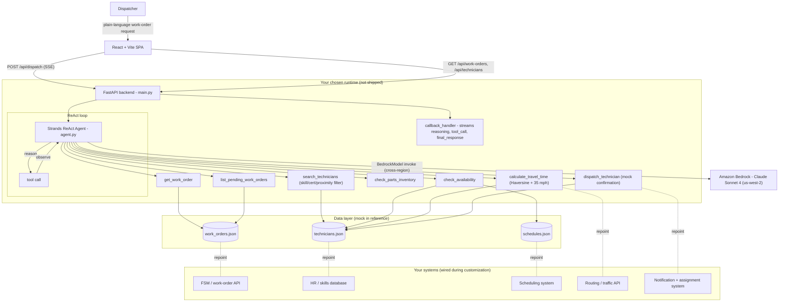

# Architecture — Field Technician Dispatch Agent

The Field Technician Dispatch Agent is a **single tool-using agent** packaged as a small two-tier app. Rather than a chain of cooperating models, it's one Strands Agents ReAct agent on Amazon Bedrock (Claude Sonnet 4) that reasons over a work order, calls seven purpose-built tools to gather facts, and recommends a technician. A FastAPI backend streams the agent's reasoning and tool calls to a React SPA over Server-Sent Events, so the dispatcher sees the logic unfold and can override before the assignment is finalized. Bedrock is the only external dependency; the seven tools read from bundled mock JSON in the reference and are repointed to your real systems during customization.

## Stack diagram

## Component responsibilities

| Component | Responsibility | You customize |
|---|---|---|
| React SPA (`frontend/src/`) | Chat interface, streamed reasoning + tool-call cards (`ToolCallCard.jsx`), work-order side panel (`WorkOrderList.jsx`/`SidePanel.jsx`), final dispatch summary (`DispatchSummary.jsx`) | Branding, layout, presentation |
| FastAPI app (`backend/app/main.py`) | API endpoints, SSE event generator, `callback_handler` that maps Strands events to SSE messages, CORS for the dev frontend | Runtime, auth, persistence |
| Strands agent (`backend/app/agent.py`) | `BedrockModel` config + `SYSTEM_PROMPT` encoding the 7-step process, priority logic, and tie-break/no-match rules | The dispatch policy in the prompt |
| Seven `@tool` functions (`backend/app/tools.py`) | Work-order lookup, pending list, technician search (skill/cert/proximity), availability, Haversine travel-time, parts check, dispatch execution | Repoint each to a real system |
| `_haversine_miles` helper | Straight-line distance for `search_technicians` and `calculate_travel_time` | Replace with real routing |
| Mock data (`backend/data/*.json`) | 8 technicians, 5 work orders (DFW metro), schedules | Replace with your own data shape |
| Amazon Bedrock | Claude Sonnet 4 invocation via cross-region inference profile | Model tier + region |

## Design decisions (summary)

The full rationale (AD1–AD11) is in [`build-spec/architecture-decisions.md`](../build-spec/architecture-decisions.md). Highlights: one ReAct agent rather than multiple cooperating agents (the capability is the prompt + tools); seven small single-purpose tools; required-skill/certification as a hard filter in `search_technicians`; priority logic kept explicit in the system prompt so it's auditable; SSE-over-POST streaming so a `message` body produces a streamed response; `calculate_travel_time` and `dispatch_technician` deliberately shipped as stubs (integration points); and decision-support, not autonomous dispatch.

## Data flow — happy path

1. The dispatcher types a work-order request (e.g. *"Dispatch a technician for WO-1003 — emergency gas leak"*) in the SPA.
2. The SPA calls `POST /api/dispatch` with `{ "message": ... }`; FastAPI starts the SSE event generator and runs the agent on a background thread.
3. The agent calls **`get_work_order("WO-1003")`** → reads `work_orders.json` → sees urgency `critical`, required skills `["plumbing", "gas fitting"]`, required cert `Gas Fitter Certification`, and the job lat/lng.
4. The agent calls **`search_technicians`** with the required skills/certs (and optionally a proximity filter) → `technicians.json` is filtered; only techs matching every required skill and certification survive.
5. For candidates, the agent calls **`check_availability`** (`schedules.json` → today's jobs + `available_from` + an `is_available_now` flag) and **`calculate_travel_time`** (Haversine distance + 35 mph → distance + estimated minutes).
6. The agent optionally calls **`check_parts_inventory`** to confirm common parts for the trade are in stock.
7. The agent applies the **priority logic** from the system prompt — for CRITICAL it picks the closest available qualified tech; for MEDIUM/LOW it optimizes best overall fit — breaking ties by rating, then experience, then cost.
8. The agent calls **`dispatch_technician(tech_id, work_order_id, reason)`** → returns a mock assignment confirmation (technician name, work-order title, reason, notification text).
9. Throughout, the `callback_handler` emits SSE `reasoning`, `text`, `tool_call`, and `final_response` messages; the SPA renders each reasoning step, a card per tool call, and a final dispatch-summary card. A `done` event closes the stream.

## Data flow — no-match / edge-case path

- If `search_technicians` returns no technician matching every required skill and certification, the system prompt directs the agent to **explain what's missing and suggest alternatives** (widen the search radius, relax a non-critical requirement, or reschedule) rather than recommend an unqualified tech.
- If multiple candidates are effectively equal, the agent applies the documented tie-break: higher rating → more years of experience → lower hourly rate.
- If a referenced work order or technician ID doesn't exist, the tools return an explicit "not found" string the agent surfaces to the dispatcher.

## Audit trail

- Every reasoning step and tool call is streamed to the dispatcher in real time, so each recommendation can be read back as "which tech, why, how far, available when."
- The final `dispatch_technician` payload records the selected technician, the work order, and the free-text `reason` the agent gave — the explainable record of the decision.
- In production, you add structured logging (e.g. CloudWatch) around the agent run and tool calls; the reference does not ship a logging/persistence layer.

## What's NOT in this architecture (intentionally)

- **No autonomous dispatch** — output is a recommendation; the human dispatcher confirms the assignment.
- **No Bedrock Knowledge Base or Guardrails** — the agent reasons from its system prompt + tool results; there's no RAG corpus and no managed guardrail in the reference.
- **No persistence** — tools read mock JSON per call; nothing is written back. Production wires real systems of record.
- **No authentication** — the demo API is open; a production deployment must add auth in front of the backend (flag during the build).
- **No real routing or notification integration** — `calculate_travel_time` is a Haversine + fixed-speed estimate and `dispatch_technician` returns a mock confirmation; both are deployment-specific integrations.
