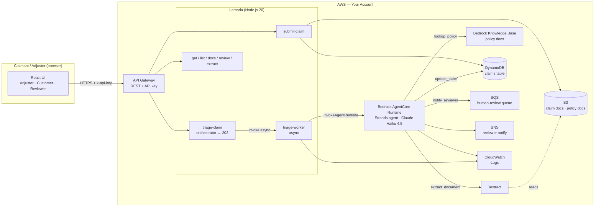

# Architecture — Intelligent Claims Triage

An agentic claims-triage pattern: a Strands agent on Bedrock AgentCore Runtime orchestrates document extraction, policy cross-reference, risk scoring, and an auto-decide-or-escalate step, wrapped in a CDK stack that handles intake, async invocation, storage, and human-review routing. The agent reasons; the deterministic boundaries (payout math, escalation threshold, API auth) are enforced explicitly.

## High-level architecture

## Component responsibilities

| Component | Responsibility | You customize |
|---|---|---|
| **React UI** | Demo workspace with adjuster, customer, and reviewer dashboards. Submits claims, triggers triage, shows the decision cross-reference. | Branding, intake fields, replace with your own portal |
| **API Gateway** | REST front door. API key + usage plan (throttle 50/100, 10k/day quota) on every method. CORS for the UI. | Auth model (swap API key for your IdP / authorizer), throttle + quota |
| **submit-claim Lambda** | `POST /claims` — writes the claim record to DynamoDB and registers uploaded document keys in S3. | Claim intake schema |
| **triage-claim orchestrator** | `POST /claims/{id}/triage` — returns 202 immediately and invokes the worker asynchronously. Keeps the API under the 29s gateway limit. | — |
| **triage-worker** | Invokes the AgentCore runtime (`bedrock-agentcore:InvokeAgentRuntime`) with a 5-minute budget; marks `AGENT_ERROR` on failure. | Timeout / retry posture |
| **AgentCore Runtime (Strands agent)** | The brain. Runs the ordered workflow, calls the four tools, applies the risk rubric and decision logic, writes the result. Claude Haiku 4.5 via inference profile. | System prompt: risk factors, weights, threshold, payout rule |
| **extract_document tool** | Amazon Textract FORMS/TABLES extraction with text-file and raw-PDF fallbacks; returns structured fields (amount, incident, dates, policy #). | Field extractors per document format |
| **lookup_policy tool** | Bedrock Knowledge Base RAG over policy documents; falls back to demo policy data when no KB is configured. | Policy corpus, retrieval query |
| **update_claim tool** | Writes status, risk score, reasoning, risk factors, payout, and the extracted-data + policy-context cross-reference to DynamoDB. | — |
| **notify_reviewer tool** | Sends escalated claims to SQS and notifies reviewers via SNS. | Queue/topic targets, message shape |
| **DynamoDB** | Claims store. PK `claimId` / SK `createdAt`; GSIs on `status` and `policyNumber`. | — |
| **S3** | Two buckets: claim documents and policy documents. | Bucket layout, retention/lifecycle |
| **CloudWatch** | Logs from the agent (tool calls, reasoning) and every Lambda. | Retention, dashboards, alarms |

## Design decisions (summary)

The full rationale is in [`build-spec/architecture-decisions.md`](../build-spec/architecture-decisions.md). The load-bearing ones:

- **AgentCore Runtime for the agent**, not a Lambda-hosted loop — the agent orchestrates multiple tool calls and LLM turns that can run for tens of seconds.
- **Async triage (202 + worker)** — triage can exceed API Gateway's 29s limit, so the orchestrator returns immediately and a worker Lambda runs the long-running invocation.
- **Escalate at risk ≥ 0.7; auto-approve below** — straight-through processing for low-risk claims, human-in-the-loop for everything risky. Deny is always a human decision.
- **RAG policy lookup with a demo fallback** — coverage validation is grounded in your actual policy documents; the hardcoded fallback exists only so the kit runs before a KB is wired.

## Data flow — happy path (auto-approve)

1. Claimant/adjuster submits a claim via the UI → `POST /claims`; `submit-claim` writes the record to DynamoDB and stores document keys.
2. UI calls `POST /claims/{id}/triage`; the orchestrator returns **202** and invokes `triage-worker` asynchronously.
3. `triage-worker` calls `InvokeAgentRuntime` on the AgentCore runtime with the claim payload.
4. The agent runs `extract_document` → Textract pulls fields from the claim PDF in S3.
5. The agent runs `lookup_policy` → Bedrock Knowledge Base returns coverage type, deductible, limit, covered perils, exclusions.
6. The agent assesses risk from the rubric (amount vs. limit, total loss, disputed liability, fraud indicators), capped at 1.0.
7. Risk < 0.7 → the agent computes `payout = min(max(amount − deductible, 0), coverageLimit)`.
8. The agent calls `update_claim` with status `APPROVED`, the payout, the reasoning, and the extracted-data + policy-context cross-reference.
9. The UI polls `GET /claims/{id}` and renders the decision with the policy citation.

## Data flow — alternate path (escalation)

When risk ≥ 0.7, steps 7–8 change:

7. The agent calls `update_claim` with status `ESCALATED`, the risk score, risk factors, and escalation reason.
8. The agent calls `notify_reviewer` → the claim is placed on the SQS human-review queue and an SNS notification fires to reviewers.
9. A human reviewer works the queue and submits a decision via `POST /claims/{id}/review`, which updates the claim.

## Alternate path — degraded extraction / no KB

- If Textract can't process a document, `extract_document` falls back to raw-PDF text scraping, then to "use claim metadata" — the agent proceeds on the submitted claim fields rather than failing.
- If `KNOWLEDGE_BASE_ID` is unset (or the KB returns nothing), `lookup_policy` returns demo/default policy data tagged with its `source`. Acceptable for smoke tests; production must wire a real KB.

## Audit trail

Every triaged claim carries its own decision record in DynamoDB:

- `status`, `riskScore`, `riskFactors`, `reasoning`, `escalationReason`
- `payoutAmount` (on approval) and `decidedAt`
- `extractedData` and `policyContext` — the exact extraction and policy snapshot the decision was based on

The agent's tool calls and reasoning stream to CloudWatch Logs (`/aws/bedrock-agentcore/runtime/<agent>` and `/aws/lambda/claims-triage-*`). Together these let a reviewer or auditor reconstruct why any claim was approved or escalated.

## What's NOT in this architecture (intentionally)

- **No auto-deny.** The agent auto-approves low-risk claims or escalates; denying a claim is always a human decision.
- **No real-time inline decisioning.** Triage is asynchronous (seconds to minutes), not a sub-second inline score.
- **No payment execution.** The agent computes a payout figure; actually disbursing funds is a downstream system you own.
- **No multi-tenancy.** One deployment per organization organization; single trust boundary.
- **No model fine-tuning.** Claude runs zero-shot with the system prompt, the extracted data, and the retrieved policy context.

## Deployment topology

Two deploy steps, in order: (1) deploy the Strands agent to AgentCore Runtime via the AgentCore CLI and capture the runtime ARN; (2) `export AGENTCORE_RUNTIME_ARN=...` then `npx cdk deploy` the CDK stack — the ARN is read at synthesis time and baked into the `triage-worker` Lambda. See `build-spec/deployment-spec.md` for the full sequence.
