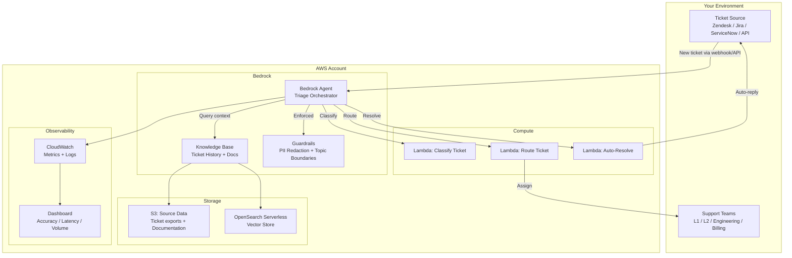

# Reference Architecture — Intelligent Ticket Triage Agent

## Overview

A Bedrock Agent that ingests support tickets from any source, classifies them by category/priority/complexity using RAG over historical ticket data, routes to the correct team, and auto-resolves common issues — all with guardrails to prevent hallucinated responses or PII leakage.

## Architecture Diagram

## Component Details

### Bedrock Agent — Triage Orchestrator
- **Model:** Claude 3.5 Sonnet (via Bedrock)
- **Role:** Receives ticket text, orchestrates classification → routing → resolution
- **Tools:** 3 action groups (Classify, Route, Resolve)
- **Behavior:** Multi-step reasoning — classifies first, then decides: auto-resolve (if confidence >90% and complexity low) or route to human (with context pre-loaded)

### Knowledge Base — Ticket History + Documentation
- **Source:** Your historical ticket data (CSV/JSON export) + product documentation
- **Chunking:** 512 tokens with 100 overlap (optimized for support ticket similarity)
- **Embedding:** Titan Embeddings v2
- **Vector Store:** OpenSearch Serverless
- **Purpose:** RAG retrieval for classification context ("what did we do last time for this type of issue?") and auto-resolution ("here's the documented fix for this problem")

### Guardrails
- **PII Redaction:** Automatically redact customer PII (emails, phone numbers, account IDs) before processing and in responses
- **Topic Boundaries:** Agent can only discuss support-related topics; refuses off-topic requests
- **Grounding Check:** Responses must be grounded in KB content (no hallucinated solutions)
- **Content Filters:** Block harmful/inappropriate content in tickets and responses

### Lambda Tools

**Classify Ticket** (`classify-ticket.py`)
- Input: Ticket text + metadata (source, customer tier, product area)
- Process: Uses KB context to classify category (bug, feature request, billing, access), priority (P1-P4), complexity (auto-resolvable, L1, L2, engineering)
- Output: Classification object with confidence scores

**Route Ticket** (`route-ticket.py`)
- Input: Classification object + routing rules (configurable per deployment)
- Process: Maps classification to team queue based on rules; enriches ticket with context from KB
- Output: Routing decision + enriched ticket for receiving team

**Auto-Resolve** (`resolve-ticket.py`)
- Input: Ticket text + KB search results
- Process: If classification is "auto-resolvable" with >90% confidence, generates resolution from KB content
- Output: Proposed response (sent to customer) OR escalation (if confidence drops)

## Data Flow

1. **Ingest:** Ticket arrives via webhook/API → triggers Agent invocation
2. **Enrich:** Agent queries KB for similar past tickets and relevant documentation
3. **Classify:** Agent calls Classify tool → returns category, priority, complexity
4. **Decide:** If auto-resolvable (>90% confidence, low complexity) → call Resolve tool. Otherwise → call Route tool
5. **Act:** Auto-resolve sends response back to ticket source. Route assigns to team with pre-loaded context
6. **Monitor:** All decisions logged to CloudWatch. Dashboard tracks accuracy, latency, auto-resolution rate

## Configuration Points (You Customize)

| What | How |
|---|---|
| Ticket source integration | Webhook URL / API credentials in `config.yaml` |
| Categories and priorities | Edit `src/agent/tools/classify-ticket.py` routing map |
| Routing rules (which team gets what) | Edit `src/agent/tools/route-ticket.py` rules |
| Auto-resolution confidence threshold | Set in `agent-config.json` (default: 0.9) |
| PII patterns to redact | Configure in Guardrails (Bedrock console or IaC) |
| Knowledge Base data | Load via `data-loader.py` with your ticket export |

## Scaling Considerations

- **Volume:** Agent handles concurrent invocations via Bedrock's managed scaling. No provisioning needed for <1000 tickets/hour.
- **Cost:** Primary cost drivers are Bedrock model invocations + Knowledge Base queries. Estimated $0.02–0.05 per ticket at average complexity.
- **Latency:** Target <5 seconds per ticket (classify + route). Auto-resolve adds 2–3 seconds for KB-grounded response generation.
