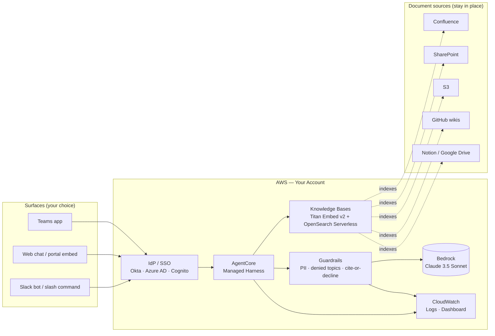

# Architecture — Internal Knowledge Q&A

A retrieval-grounded Q&A agent built on AgentCore Managed Harness with Knowledge Bases for retrieval and Guardrails for policy enforcement. Single-tenant; one organization, one corpus.

## Reference architecture

## Component responsibilities

| Component | Responsibility | You customize |
|---|---|---|
| **AgentCore Managed Harness** | Hosts the agent loop. AWS manages compute, sandbox, memory, identity, observability, agent runtime. | System prompt, tool definitions (none for v1), retrieval config |
| **Knowledge Bases** | Document ingestion, chunking, embedding, retrieval. Reads from your existing sources — does not copy documents. | Source connections, refresh cadence, chunking strategy if non-default |
| **Guardrails** | Policy enforcement on input + output. PII redaction, off-topic refusal, denied-topics filter, citation requirement, no-fabrication enforcement. | Denied topics list (vertical-specific), escalation language, PII pattern set |
| **Bedrock** | Foundation model invocation. Claude 3.5 Sonnet by default. | Model override per account / region availability |
| **IdP / SSO** | Authentication and audit identity. Your existing IdP. | Your existing setup — kit consumes via OIDC / SAML |
| **CloudWatch** | Observability. Query log, citation rate, refusal rate, latency, top documents accessed. | Dashboard layout, alert thresholds |

## Design decisions (summary)

Full reasoning lives in [`build-spec/architecture-decisions.md`](../build-spec/architecture-decisions.md). Highlights:

- **Why managed-harness, not custom-iac?** The value of this kit is in the prompt + retrieval contract + guardrails, not in custom infrastructure. AgentCore handles the agent runtime so you can focus on the corpus and channel integration.
- **Why Knowledge Bases over building RAG from scratch?** Native connectors for Confluence, SharePoint, S3 cover the 80% case. Skip the chunking / embedding / vector store glue code unless you have a genuinely unusual source.
- **Why Claude 3.5 Sonnet?** Strong instruction-following on the cite-or-decline rule. Anthropic's GA model on Bedrock. You can override per your account's model access.
- **Why single-tenant?** Multi-tenant with per-document ACLs is meaningfully more complex (row-level security, group-aware retrieval, identity-aware citations). Out of scope for v1; build a different kit if needed.

## Data flow — happy path

1. Employee asks a question via Slack / web / Teams
2. Channel forwards the request to the harness with the user's SSO identity
3. Harness logs the inbound query (CloudWatch)
4. Harness invokes Guardrails on the input → PII redacted, off-topic check
5. Harness retrieves relevant chunks from Knowledge Bases
6. Harness invokes Bedrock with the system prompt + retrieved chunks + user query
7. Model generates answer with inline citations
8. Harness invokes Guardrails on the output → citation check, denied-topics check
9. Harness returns answer + citation links to the channel
10. Harness logs the outbound response (CloudWatch)

## Data flow — declined-answer path

If the retrieval doesn't surface relevant chunks, or the model can't ground its answer, the system prompt instructs the model to say:

> "I don't have a documented answer for that. Try asking [escalation path] or check [pointer to the right team's wiki space]."

This is the **cite-or-decline contract**. Don't soften it; declining is the correct behavior when the corpus doesn't have the answer.

## Audit trail

Every query and response is logged to CloudWatch with:
- Timestamp
- User identity (from SSO)
- Question (post-PII-redaction)
- Retrieved chunk IDs
- Cited document URIs
- Answer text
- Guardrail intervention type (if any: redaction, refusal, denied topic)

This log is your defense for "what did the agent tell employees about policy X?" Retain per your data retention policy.

## What's NOT in this architecture (intentionally)

- **No human handoff system.** The decline message points to the right human; integrating with a ticketing system is a your side extension.
- **No multi-modal input.** Text only. Voice / image is a different kit.
- **No write actions.** The agent retrieves and answers; it doesn't update Confluence, create Jira tickets, or send emails. Action-taking agents are a different threat model.
- **No memory of past conversations across sessions.** Each session is independent. Persistent user-level memory adds complexity (and privacy questions) out of scope for v1.
