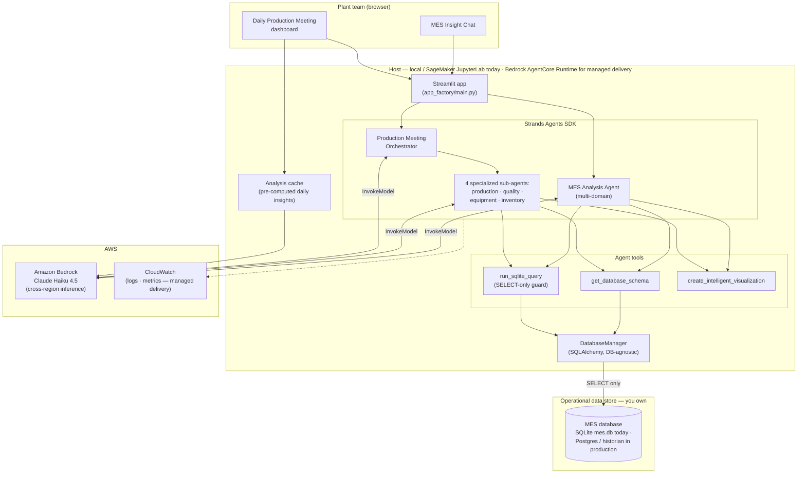

# Reference Architecture — Manufacturing Operations Hub

## Overview

A schema-first text-to-SQL agent over manufacturing (MES) data. A natural-language question goes to a Strands Agents SDK agent running on Amazon Bedrock; the agent reads the database schema, writes a read-only SQL query, executes it through a DB-agnostic SQLAlchemy layer, and returns results with an auto-selected visualization. Two surfaces share the same data layer and tools: an **MES Insight Chat** for ad-hoc analysis, and a **Daily Production Meeting** dashboard whose orchestrator fans a briefing out to four specialized sub-agents (production, quality, equipment, inventory). Read-only by design — a SELECT-only guard blocks any write before it reaches the database.

## Architecture diagram

## Component responsibilities

| Component | Responsibility | You customize |
|---|---|---|
| **Streamlit UI** (`app_factory/main.py`) | Hosts both surfaces — MES Insight Chat and the Daily Production Meeting dashboard (tabs, action tracker, meeting notes, reports). Shows agent progress + the generated SQL. | Branding, tab layout, which dashboards lead, meeting cadence |
| **MES Analysis Agent** (`mes_agents/`) | Single multi-domain agent (Strands agent-as-tools). Parses the question, reads schema, writes + runs SQL, synthesizes an answer, picks a chart. Persistent per day. | System prompt (domain, tables, KPI vocabulary), analysis depth |
| **Production Meeting Orchestrator** (`production_meeting_agents/`) | Classifies a query (daily-briefing / multi-domain / single-domain) and routes to the right sub-agent(s); a briefing calls all four and synthesizes. | Routing keywords, briefing format, sub-agent prompts |
| **Specialized sub-agents** (production / quality / equipment / inventory) | Domain-focused agents, each with its own system prompt + the shared tools plus `get_production_context`. | Per-domain prompts, metrics each focuses on |
| **Agent tools** (`tools/`) | `run_sqlite_query` (SELECT-only guarded, with error analysis), `get_database_schema` (introspection), `create_intelligent_visualization` (chart selection). | Tool descriptions, chart heuristics |
| **DatabaseManager** (`shared/database.py`) | DB-agnostic data access via SQLAlchemy `engine` + `inspect()`; schema introspection cached 5 min; parameterized canned queries for the dashboards. | Connection string (SQLite → Postgres/historian), canned queries |
| **Analysis cache + scheduler** (`production_meeting/`) | Pre-computes daily AI insights across all domains and caches them as JSON for sub-second dashboard loads. | Schedule, which insights are pre-computed |
| **Amazon Bedrock** | Serves the model (Claude Haiku 4.5 via cross-region inference; Nova / Claude Sonnet also supported). | Model choice, region |
| **CloudWatch** *(managed delivery)* | Logs + metrics when the agent is hosted on AgentCore Runtime rather than run locally. | Dashboard, alarms, retention |

## Design decisions (summary)

- **Managed-harness, not custom-IaC** — the value is the prompt + tools + read-only data layer; there's no orchestration that justifies a CFN stack with action-group Lambdas.
- **Schema-first text-to-SQL** — the agent reads the schema before writing SQL and grounds every query in real tables/columns, rather than relying on a hand-maintained semantic layer.
- **Read-only by construction** — a keyword guard rejects writes before execution; the recommended deployment also connects with a read-only DB user.
- **DB-agnostic SQLAlchemy layer** — makes the SQLite-to-production-database migration a connection change, not a rewrite.

Full rationale in [`build-spec/architecture-decisions.md`](../build-spec/architecture-decisions.md).

## Data flow — happy path (MES Insight Chat)

1. A user asks a question in natural language (e.g. *"Which work centers are behind schedule this week and why?"*).
2. The Streamlit UI passes the query to the MES Analysis Agent (Strands).
3. The agent calls `get_database_schema` to retrieve tables, columns, foreign keys, and sample rows (served from a 5-minute cache when warm).
4. The agent writes a SQL query grounded in that schema and calls `run_sqlite_query`.
5. `run_sqlite_query` runs `_validate_query` — rejecting any write keyword — then executes the SELECT through the SQLAlchemy `DatabaseManager`.
6. Results return as structured rows + column metadata; the agent may issue follow-up queries for multi-step analysis.
7. The agent calls `create_intelligent_visualization` to pick an appropriate chart for the result shape.
8. The agent synthesizes a concise, data-grounded answer with the metrics, the chart, and the generated SQL shown.
9. The UI renders the answer + progress trail and suggests relevant follow-up questions.

## Data flow — daily briefing (Production Meeting)

1. A user requests a daily briefing (or opens the dashboard, which uses pre-computed cached insights).
2. The orchestrator classifies the request as `daily_briefing` and calls all four specialized sub-agents.
3. Each sub-agent reads schema as needed and runs read-only queries against its domain tables (WorkOrders, QualityControl, Machines/OEE/Downtimes, Inventory/Suppliers/MaterialConsumption).
4. The orchestrator synthesizes the four results into a meeting-ready briefing: **Critical Issues → Key Metrics → Recommendations**.
5. The dashboard renders pre-computed KPIs (completion rates, OEE, defect rates, inventory alerts) alongside the AI briefing.

## Data flow — error / empty-result path

- On a SQL error, `run_sqlite_query` returns a structured error with root cause, recovery options, and educational tips (via `IntelligentErrorAnalyzer`); the agent reformulates and retries or explains what's missing.
- On an empty result, the agent states that no rows matched and suggests relaxing the most-restrictive constraint — it does **not** fabricate plausible-looking rows.
- On a blocked write attempt, `_validate_query` returns a validation error ("Modifying operations are not allowed. Use SELECT queries only.") before the database is touched.

## Audit trail

- Every executed query is logged by the `DatabaseManager` (query text + row count + execution time).
- For a managed AgentCore deployment, queries, tool calls, and responses are logged to CloudWatch with structured fields; the visible generated SQL plus the logged query give a reproducible trail for any answer.
- Because the agent is read-only, the audit story is "what was read and what SQL produced this answer" — there are no write actions to audit.

## What's NOT in this architecture (intentionally)

- **No write or control path.** The agent reads operational data; it never updates the MES, adjusts schedules, or actuates equipment. That's a different threat model.
- **No real-time / streaming ingestion.** The agent queries the operational store as it stands; it isn't a historian or a streaming pipeline.
- **No RAG knowledge base.** Answers come from live SQL against structured data, not document retrieval. (A KB could be added for tribal-knowledge context, but it isn't core to this kit.)
- **No fine-tuning.** The model runs zero-shot with the schema + system prompt. Fine-tuning would couple the kit to one your data and reduce reusability.
- **No multi-tenant data blending.** Each deployment points at one your operational store — a single-tenant trust boundary.

## Scaling considerations

- **Query load on the source DB.** Ad-hoc agent-written SQL hits the operational store. For anything beyond a demo, point the agent at a **read replica or reporting store**, not the live transactional OLTP database, and connect with a read-only user.
- **Schema size.** Very wide schemas inflate the schema-introspection payload; the 5-minute cache helps, but for large schemas consider scoping `get_database_schema` to the relevant tables or summarizing the schema in the prompt.
- **Cost / latency.** Primary driver is Bedrock invocations. Claude Haiku 4.5 keeps per-query cost and latency low; Claude Sonnet is available when a you want deeper multi-step reasoning at higher cost.
- **Concurrency.** Hosting the Strands agent on Bedrock AgentCore Runtime gives per-session isolation and managed scaling for many concurrent users, versus a single shared Streamlit process.
