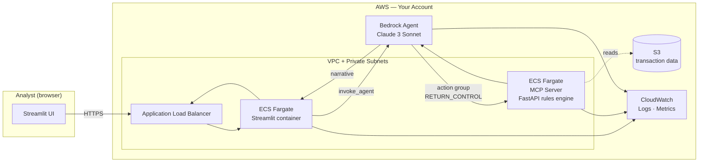

# Architecture — Payment Fraud Detector

A hybrid fraud-detection agent: deterministic rules engine + Bedrock-powered LLM analyst layer. The two are deliberately separated so you get fast, audit-friendly rule fires *and* analyst-grade narrative summaries.

## High-level architecture

## Component responsibilities

| Component | Responsibility | You customize |
|---|---|---|
| **Streamlit UI** | Analyst workspace. Tabs for dashboard, alerts, raw data, senders, coordinators. Invokes Bedrock Agent and renders rule fires + LLM narrative. | Branding, dashboard layout, analyst workflow tabs |
| **Bedrock Agent** | Orchestrator. Receives the user's question, invokes the rules engine via action group, asks Claude to summarize, returns narrative. | System prompt, action group definitions, model choice |
| **MCP Server (rules engine)** | Deterministic detection. Pure-Python FastAPI service running rules: unregistered receivers, threshold avoidance ($45–49.99 clustering), self-dealing patterns, excessive frequency. ~35 ms per analysis. | Rule modules per vertical (AML, FWA, etc.), schema definitions |
| **ECS Fargate + ALB** | Container runtime. Two services (Streamlit + MCP), both behind one ALB. Auto-scaling configured. | Task counts, autoscaling thresholds, instance sizing |
| **S3** | Transaction data store. Synthetic data shipped with the kit; you replace it with your own data. | Bucket layout, object schema |
| **CloudWatch** | Observability. Logs from all three containers, ALB access logs, Bedrock Agent invocation traces. | Dashboard layout, alarm thresholds |

## Why the rules-vs-LLM split

The defining design choice. Three reasons it's separate:

1. **Speed and cost.** Rules run in ~35 ms per transaction in pure Python. Sending every transaction through Claude would be 100x slower and cost 100x more. The rules engine triages; the LLM analyzes.
2. **Auditability.** "Why did the model flag transaction X?" gets two answers: the deterministic rule that fired (with parameters) and the LLM's narrative on top. Compliance teams accept the first; analysts care about the second.
3. **Trust.** Many teams won't deploy a black-box ML model into payment fraud. A rules engine you can read + an LLM that explains is much easier to get past your model risk management teams.

Full rationale is distilled in [`build-spec/architecture-decisions.md`](../build-spec/architecture-decisions.md).

## Data flow — happy path

1. Analyst opens the Streamlit UI, picks a data source (Local Folder or S3) and a payment scenario
2. Streamlit calls Bedrock Agent's `InvokeAgent` with the analyst's prompt
3. Bedrock Agent matches an action group — e.g. `analyze_payment_patterns`
4. Action group fires through `RETURN_CONTROL` to the MCP server endpoint behind the ALB
5. MCP server runs all rules, collects fires, returns structured JSON to the agent
6. Bedrock Agent invokes Claude with the rule output + the analyst's original question
7. Claude generates a narrative summary explaining what was flagged and why
8. Agent returns the response (rule fires + narrative) to Streamlit
9. Streamlit renders both the structured alerts and the LLM analysis side-by-side

## Data flow — alternate (Claude-only)

`scripts/claude_only_fraud.py` skips the rules engine entirely and asks Claude to find fraud in the raw transaction data. Useful for a demo comparing:

- Rules-only → fast, complete, but miss novel patterns
- Claude-only → finds novel patterns, but slow + expensive at scale + harder to audit
- Hybrid (this kit's primary path) → best of both

## Audit trail

Every flagged transaction gets logged with:
- Timestamp + analyst identity (from SSO if integrated)
- Rule(s) that fired with your thresholds and matched values
- LLM narrative explanation
- Source data identifier (S3 key or local file path)
- Bedrock Agent invocation ID for trace replay

Logs go to CloudWatch. Your compliance team can replay any flagged decision after the fact.

## What's NOT in this architecture (intentionally)

- **No real-time inline scoring.** This kit is for analyst review of transaction batches, not transaction-time decisioning. Real-time inline is a different threat model with much stricter latency requirements.
- **No auto-block / auto-action.** The agent surfaces and explains; humans decide. Auto-blocking flagged transactions adds liability and a different review cycle.
- **No on-prem deployment.** ECS+ALB+Bedrock is cloud-native. If you need on-prem inference, you'd need a different stack (e.g., Bedrock + Outposts).
- **No model fine-tuning.** Claude runs zero-shot with rules context and the analyst's prompt. Fine-tuning would couple the kit to one organization's data and reduce reusability.
- **No cross-customer data sharing.** Each deployment is a single-tenant trust boundary.

## Deployment topology

The spec targets a multi-stack CFN setup (master + children for VPC, ECS cluster, MCP service, Streamlit service, ALB, agent). This matches enterprise teams' expectation of separable concerns. Don't collapse to one stack.

See [`build-spec/deployment-spec.md`](../build-spec/deployment-spec.md) for the full master-stack walkthrough.
