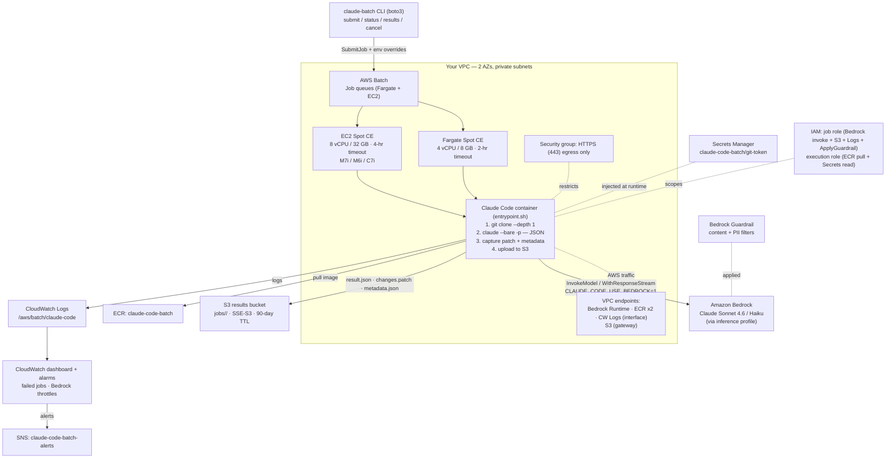

# Architecture — Scalable Claude Code on AWS Batch

This kit turns a coding agent into a **queue-and-fan-out batch workload**. Instead of one long-running service, work is submitted as discrete AWS Batch jobs; each job is a short-lived container that clones a repo, runs Claude Code headlessly against Bedrock, and writes its output to S3. AWS Batch owns concurrency and auto-scaling across Fargate/EC2 Spot compute; Bedrock supplies the model over IAM (no API keys); a per-job dollar budget and a Bedrock Guardrail bound spend and content. Infrastructure is a four-stack AWS CDK app deployed into your own account.

## Stack diagram

Deployment is four CDK stacks: **NetworkStack** (VPC + endpoints) and **StorageStack** (ECR + S3) feed **BatchStack** (compute, IAM, Guardrail, secrets, job defs), which feeds **MonitoringStack** (dashboard, alarms, SNS).

## Component responsibilities

| Component | Responsibility | You customize |
|---|---|---|
| `claude-batch` CLI (`cli/`) | Submit single/bulk jobs, watch status, download results, cancel; resolve config from CDK outputs | Default model, budget, allowed-tools (`config.py`) |
| NetworkStack (`infra/lib/network-stack.ts`) | VPC (2 AZs, 1 NAT), interface endpoints (Bedrock/ECR/Logs), S3 gateway endpoint | AZ count, NAT redundancy, region |
| StorageStack (`infra/lib/storage-stack.ts`) | ECR repo (10-image lifecycle), encrypted S3 results bucket (90-day TTL) | Bucket retention, encryption (SSE-S3 → SSE-KMS) |
| BatchStack (`infra/lib/batch-stack.ts`) | Compute envs, job queues, job definitions, IAM roles, Bedrock Guardrail, git-token secret, egress SG | Model allow-list, Guardrail policy, vCPU/memory, timeouts |
| Claude Code container (`docker/`) | Clone repo, run `claude --bare -p` with budget + tools, capture patch/metadata, upload to S3 | Toolchains in `Dockerfile`, job logic in `entrypoint.sh` |
| MonitoringStack (`infra/lib/monitoring-stack.ts`) | Dashboard (job/Bedrock metrics), failed-job + throttle alarms, SNS topic | Thresholds, alert subscribers |
| Job manifests (`examples/*/manifest.json`) | Declare repos, prompts, budgets, compute type, tools for a campaign | The whole campaign definition |

## Design decisions (summary)

Full rationale is in [`build-spec/architecture-decisions.md`](../build-spec/architecture-decisions.md). Highlights: Bedrock-with-IAM instead of API keys (AD1); AWS Batch as the fan-out engine rather than a bespoke orchestrator (AD2); Fargate Spot default with an EC2 Spot path for big jobs (AD3); a hard per-job budget as the primary cost control (AD4); least-privilege split IAM roles (AD5); VPC endpoints + HTTPS-only egress (AD6); a Bedrock Guardrail in the loop (AD7); and S3 as the result sink with structured JSON + git patch (AD8). The dominant scaling bottleneck is Bedrock TPM/RPM quota, not compute.

## Data flow — submission → execution → collection

1. The user runs `claude-batch submit --prompt "…" --repo-url <url>` (or `--manifest <file>` for bulk).
2. The CLI calls AWS Batch `SubmitJob` with container environment overrides (`TASK_PROMPT`, `REPO_URL`, `MAX_BUDGET_USD`, `ALLOWED_TOOLS`, optional `CLAUDE_MODEL`/`MAX_TURNS`/`SYSTEM_PROMPT`).
3. Batch places the job on the Fargate or EC2 queue and scales the matching Spot compute environment to run it.
4. The container is pulled from ECR; `entrypoint.sh` initializes an isolated `CLAUDE_CONFIG_DIR` and (if a repo URL is given) `git clone --depth 1` — using the Secrets Manager git token for private repos.
5. If `TASK_PROMPT` is an `s3://` URI, the prompt is downloaded from S3.
6. `claude --bare -p "<prompt>" --output-format json --max-budget-usd <n> --allowedTools …` runs headlessly.
7. Claude Code calls **Bedrock** through the VPC interface endpoint (`CLAUDE_CODE_USE_BEDROCK=1`) — traffic never leaves the AWS network; the Guardrail filters prompts and responses.
8. The container writes `result.json`, captures `git diff` as `changes.patch` (+ `changes-summary.txt`, `new-files.txt`), and writes `metadata.json` (timing, exit code, model, budget).
9. All artifacts are uploaded to `s3://<bucket>/jobs/<job-id>/`.
10. The user polls `claude-batch status --watch` and retrieves output with `claude-batch results <job-id> --show | --changes | -o <dir>`.

## Data flow — failure & retry paths

- **Retry:** job definitions set `retryAttempts: 2` and retry on `Host EC2*` status reasons (Spot reclamation) while exiting on application exit code 1.
- **Budget exhaustion:** Claude Code stops when `--max-budget-usd` is reached; the job still uploads whatever it produced.
- **S3 upload failure:** the entrypoint preserves the original exit code and sets exit code 2 so a lost-result job is visibly failed, not silently green.
- **No results bucket set (local runs):** output is printed to container logs instead of S3.

## Audit trail

- Every job emits structured logs to the `/aws/batch/claude-code` CloudWatch log group (stream-prefixed per compute type).
- `metadata.json` per job records job ID, timestamp, exit code, repo URL/branch, budget, model, and prompt length.
- CloudWatch dashboard tracks job outcomes (running/pending/succeeded/failed) and Bedrock invocations/latency/throttles; alarms fire to SNS on >10 failed jobs in 5 min or sustained throttling.
- For compliance, the README recommends enabling CloudTrail data events on the results bucket (a day-2 item you own).

## What's NOT in this architecture (intentionally)

- **No auto-merge / auto-push** — jobs produce patches and reports; humans review and merge what lands in repos.
- **No persistent control-plane database** — job state lives in AWS Batch and results in S3; there is no separate app datastore.
- **No multi-tenant sharing model** — one deployment per organization account; per-team roles/queues are a production add-on, not shipped.
- **No authentication in front of the CLI** — access is governed by the operator's AWS IAM credentials, not an app-level auth layer.
- **No KMS-managed encryption by default** — the results bucket uses SSE-S3; SSE-KMS is a documented hardening option.
