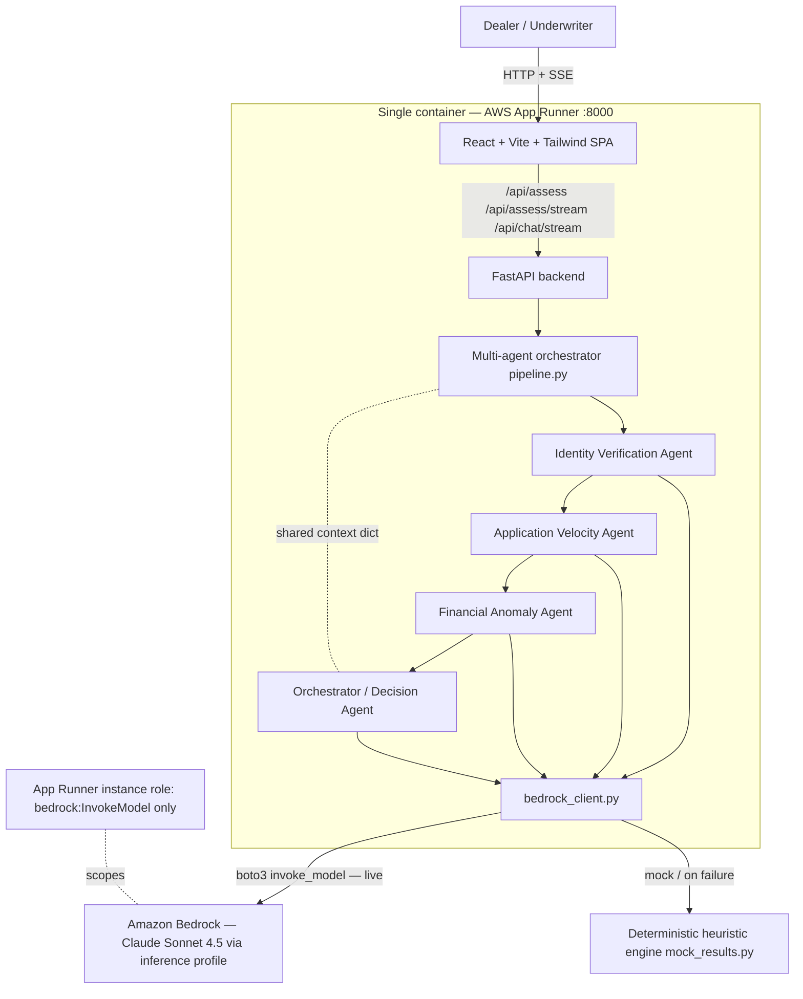

# Architecture — Sentinel Auto-Loan Fraud Detection

Sentinel is a **multi-agent pipeline** packaged as a single container. Rather than one large model call, it decomposes fraud screening into four specialist Bedrock (Claude) agents that run in sequence over a shared context, then a deterministic orchestrator synthesizes them into an explainable verdict. The whole app — React SPA + FastAPI API — ships as one image to App Runner, with Bedrock as the only external dependency and a deterministic heuristic engine as the always-available fallback.

## Stack diagram

Deploy path: `infra/deploy-codebuild.sh` zips the source to **S3** → **CodeBuild** builds the image → **ECR** → **App Runner** pulls and runs it. Logs land in **CloudWatch**.

## Component responsibilities

| Component | Responsibility | You customize |
|---|---|---|
| React SPA (`frontend/`) | Dashboard, new-assessment form, assessment detail, animated agent network, score-contribution chart, analyst chat | Branding, layout, presentation |
| FastAPI app (`backend/main.py`) | API endpoints, SSE streaming, single-origin SPA serving, in-memory store | Persistence layer, auth |
| Pipeline (`backend/pipeline.py`) | Sequences the four agents, threads the shared context, assembles the `Assessment` | Agent sequence (rarely) |
| Identity / Velocity / Financial agents | Each scores one fraud dimension via its own Claude system prompt; returns `risk_score` + findings | System prompts per product |
| Orchestrator agent | Deterministic weighted score → APPROVE/FLAG/DECLINE + confidence + narrative + top factors | Weights and cutoffs |
| Heuristic engine (`mock_results.py`) | Deterministic rule logic + score contributions behind every agent | Rules and thresholds |
| Bedrock client (`bedrock_client.py`) | boto3 `invoke_model`, model tiers, mock/live toggle, streaming, JSON extraction, fallback | Model tier selection |
| App Runner + IAM | Hosts the container; least-privilege Bedrock instance role | Account, region, naming |

## Design decisions (summary)

The full rationale (ADR-style DD-1…DD-7) is in the source's `aidlc-docs/construction/design-decisions.md` and distilled in [`build-spec/architecture-decisions.md`](../build-spec/architecture-decisions.md). Highlights: deterministic engine behind every agent (never hard-fail), deterministic score with LLM-supplied narrative, Sonnet 4.5 default with Opus 4.8 offered for batch, equal-weight scoring plus a peak-signal term, and SSE-over-POST for streaming.

## Data flow — happy path (live Bedrock)

1. Dealer submits a `LoanApplication` (or loads a sample) via the SPA.
2. SPA calls `POST /api/assess/stream`; FastAPI starts the streaming pipeline.
3. **Identity agent** invokes Claude with the application JSON, returns `identity_risk_score` + findings; result is written to the shared context.
4. **Velocity agent** runs with the application + identity context, returns `velocity_risk_score` + findings.
5. **Financial agent** runs with all prior context, returns `financial_risk_score` + findings.
6. The orchestrator computes the **deterministic weighted final score** (`0.25·identity + 0.25·velocity + 0.25·financial + 0.25·peak`) and maps it to APPROVE / FLAG / DECLINE.
7. The orchestrator invokes Claude to produce the **narrative** and **top risk factors**, but the score and verdict from step 6 remain authoritative.
8. Each step emits an SSE `agent_start` / `agent_complete` event so the UI animates the agent network and progress tracker live.
9. A final `complete` event carries the assembled `Assessment` (score, recommendation, confidence, per-dimension contributions, narrative); it's stored and rendered.
10. The underwriter can open **Ask the Analyst** (`/api/chat/stream`) for grounded, token-streamed follow-up questions about the assessment.

## Data flow — fallback path

- If a Bedrock call fails (no creds, throttling, malformed JSON), `bedrock_client.invoke_agent` returns `None` and the agent falls back to the **deterministic heuristic engine**. Each agent card shows a provenance badge (`◆ Bedrock` + latency vs. `◆ heuristic`), so it's always visible which path produced a result.
- **Mock mode** (`MOCK_MODE=true`, the local default) skips Bedrock entirely — deterministic, instant, reproducible. Used for the demo, the seeded dashboard, and tests.

## Audit trail

- Each `AgentResult` records its `source` (`bedrock` vs `heuristic`), `model`, and `latency_ms` — provenance is captured per agent, not just globally.
- The `Assessment` retains every agent's score and findings plus the per-dimension `contributions`, so a verdict can always be decomposed into why each dimension scored as it did.
- App Runner / Bedrock invocation logs land in CloudWatch.

## What's NOT in this architecture (intentionally)

- **No autonomous funding action** — output is decision-support; the human underwriter decides.
- **No persistent database** — the reference uses an in-memory store seeded with three deterministic assessments (DD-7). Production needs a real datastore; that's a customization, not shipped.
- **No authentication layer** — the demo API is open; a production deployment must add auth in front of App Runner (flag during the build).
- **No external credit-bureau / KYC integrations** — agents reason over the submitted application attributes; live data-source integrations are your own.
