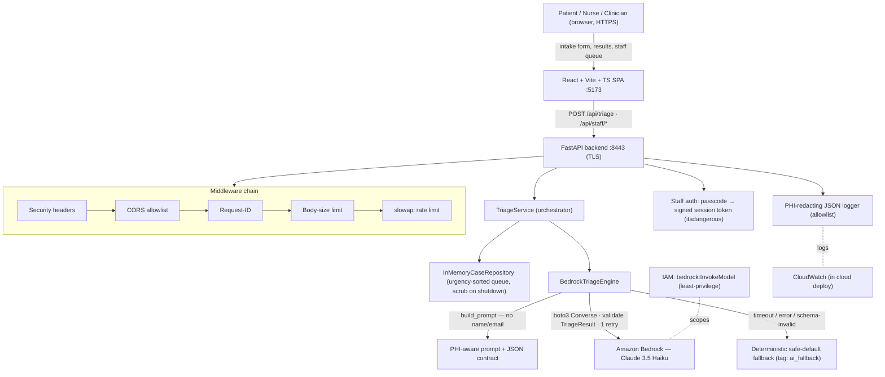

# Architecture — TriageAI Patient Triage

TriageAI is a **two-tier web application** — a React SPA and a FastAPI backend — with a **single constrained Bedrock (Claude) call** at its core. Rather than a multi-agent pipeline or an AgentCore harness, an intake form is turned into one schema-validated Converse request; the model returns structured triage JSON, which is validated, persisted, and routed into a staff queue. A deterministic safe-default fallback sits behind the model so the flow never stalls, and PHI is kept out of the prompt and the logs by construction.

## Stack diagram

The reference runs **local-only** over self-signed TLS; the only external dependency is the in-region Bedrock model call. There is no cloud IaC in v1 — taking it to your account (compute host, persistent store, auth in front) is the production build, and the `bedrock:InvokeModel` IAM policy and `CloudWatch` log destination are the AWS surfaces that come with it.

## Component responsibilities

| Component | Responsibility | You customize |
|---|---|---|
| React SPA (`frontend/`) | Intake form (patient/nurse toggle), result view, staff login, urgency-sorted queue, case detail, urgency badges | Branding, form fields, layout |
| FastAPI app (`api/app.py`) | App wiring, middleware order, routers, lifespan startup/scrub | Host, persistence, auth hardening |
| `TriageService` (`triage/service.py`) | Orchestrates validate → create PENDING case → triage → mark TRIAGED/fallback | Rarely |
| `BedrockTriageEngine` (`triage/bedrock.py`) | Builds prompt, calls Converse, validates JSON, retries once, falls back | Timeout/retry budget |
| Triage prompt (`triage/prompt.py`) | The clinical instructions + strict JSON output contract; excludes PHI | Prompt content per clinical model |
| Domain (`domain/models.py`, `enums.py`) | `TriageRequest` / `TriageResult` / `Case`; urgency + department taxonomy | Intake schema, taxonomy |
| Fallback (`triage/fallback.py`) | Deterministic safe-default `TriageResult` when the model is unavailable | Default routing |
| Repository (`repository/memory.py`) | In-memory store; queue ordered urgency-desc, submitted-at-asc; scrub on shutdown | Replace with persistent store |
| Auth (`api/auth.py`) | Passcode → signed, expiring session token; constant-time compare; Bearer gate | Replace with your IdP |
| Middleware + logger | 5 security headers, body-size limit, request-id, CORS allowlist, rate limiting, PHI-redacting JSON logs | Allowlist fields, limits |

## Design decisions (summary)

The full rationale is distilled in [`build-spec/architecture-decisions.md`](../build-spec/architecture-decisions.md) and grounded in the source's `aidlc-docs/` business rules (`RULE-AI-*`, `RULE-STAFF-*`, `RULE-QUEUE-*`, `LOG-*`). Highlights: one constrained Converse call (not multi-agent, not a harness); deterministic safe-default behind the model (never hard-fail); strict enum-constrained, schema-validated JSON output; PHI excluded from prompt and logs by construction; in-memory store for the prototype (production needs persistence); human clinician owns the decision.

## Data flow — happy path (live Bedrock)

1. A patient or nurse fills the intake form in the SPA (name, email, age, sex, symptom description, duration, pain level, known conditions, submitted-by).
2. The SPA validates client-side, then calls `POST /api/triage`; the request passes the security/CORS/request-id/body-size/rate-limit middleware chain.
3. `TriageService` creates a `PENDING` `Case` in the repository.
4. `BedrockTriageEngine.build_prompt` constructs a single user turn from the clinical fields **only** — `patient_name` and `email` are excluded by design.
5. The engine calls Bedrock **Converse** (`anthropic.claude-3-5-haiku…`, `maxTokens` 1024, `temperature` 0.2) on a worker thread under an 8s budget.
6. The response text is stripped of any code fences, parsed as JSON, and validated against `TriageResult`; the engine injects the `model_id`.
7. On schema-invalid output the engine retries **once**; on success it returns a `TriageOutcome`.
8. `TriageService` marks the case `TRIAGED`, storing urgency, department, reasoning, red flags, follow-up questions, and `triaged_at`.
9. The API returns `{ case_id, result, is_fallback: false }`; the SPA renders the result page (urgency badge, department, next steps, red flags).
10. The case appears in the staff queue (`GET /api/staff/cases`, Bearer-gated), sorted urgency-desc then submitted-at-asc, so critical cases surface at the top; staff open case detail for the full reasoning.

## Data flow — fallback path

- If the Converse call times out, raises an AWS error, or returns schema-invalid JSON after the single retry, `BedrockTriageEngine` returns `build_fallback_result()` — **MEDIUM urgency, Primary Care**, `model_id="fallback"`.
- `TriageService` marks the case `TRIAGED` and adds the `ai_fallback` tag; the result page shows an "AI temporarily unavailable" banner and the staff queue shows an "AI fallback" marker, so the human reviewer always knows a case bypassed the model.

## Audit trail

- Structured JSON logs capture lifecycle events (`case_created`, `triage_completed`, `case_triaged` / `case_triaged_fallback`, `triage_fallback`, `staff_login_succeeded/failed`) with `case_id`, `request_id`, `urgency`, `department`, `is_fallback`, `latency_ms`, and `model_id` — and **never** PHI (the logger is allowlist-first with a defense-in-depth PHI-marker scan).
- Each case records `submitted_at`, `triaged_at`, `status`, and the `ai_fallback` tag, so any routing decision can be reconstructed and attributed to model-vs-fallback.
- In a cloud deployment these logs land in CloudWatch (retention/alarms are a day-2 task for you).

## What's NOT in this architecture (intentionally)

- **No autonomous clinical action** — output is decision-support; the human clinician decides and the staff queue is the handoff.
- **No persistent database** — the reference uses an in-memory store scrubbed on shutdown (PHI hygiene for a prototype). Production needs a real encrypted store; that's a customization, not shipped.
- **No real identity provider** — staff access is a shared passcode → signed session token for the demo. Production should front it with your IdP.
- **No EHR / scheduling / messaging integration** — the agent reasons over the submitted intake only; downstream integrations are your own.
- **No cloud IaC in v1** — the reference is local-only; the deployment target (compute host, store, auth) is defined in [`build-spec/deployment-spec.md`](../build-spec/deployment-spec.md) and built per deployment.
