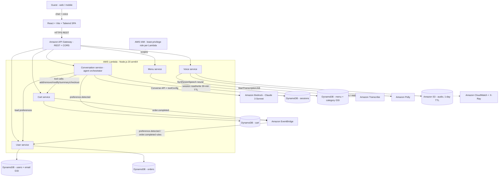

# Architecture — TropiCraft Ordering Agent

TropiCraft is a **serverless microservice** architecture with a single conversational brain. A React SPA talks to one API Gateway that fronts **five Lambda services**. The **Conversation service** is the agent: it calls **Amazon Bedrock (Claude 3 Sonnet) via the Converse API with tool use**, runs a multi-round tool loop against the Cart service, and keeps per-session state in DynamoDB. The Menu, Cart, User, and Voice services are plain Lambdas the agent (and the SPA) call. The whole backend is one **AWS CDK** stack; Bedrock, Transcribe, and Polly are the managed AI dependencies.

## Stack diagram

Deploy path: AWS CDK (TypeScript) synthesizes one **CloudFormation** stack that provisions all Lambdas, DynamoDB tables, the API, EventBridge rules, the S3 audio bucket, IAM roles, and a CloudWatch dashboard. The frontend SPA is hosted separately (the CDK stack provisions the backend only).

## Component responsibilities

| Component | Responsibility | You customize |
|---|---|---|
| React SPA (`frontend/`) | Chat UI, cart panel, voice controls, auth; React Context state | Branding, layout, hosting |
| Conversation Lambda (`services/conversation/`) | The agent: builds the system prompt, calls Bedrock Converse, runs the tool-use loop, manages session state + state machine, emits preference events | Prompt, tools, model config |
| `prompt-builder.ts` | Injects menu, dietary-safety rules, upsell governor, live cart, time/season/taste context into the system prompt each turn | Persona, safety + upsell rules |
| `tool-definitions.ts` / `tool-executor.ts` | The five Bedrock tools and your Cart-service handlers | Action set, checkout behavior |
| Menu Lambda (`services/menu/`) | Menu items, search, category GSI, dietary filtering | Menu data, filters |
| Cart Lambda (`services/cart/`) | Cart CRUD, pricing, tax, checkout/order confirmation, `order.completed` event | Pricing, tax, checkout/payment |
| User Lambda (`services/user/`) | Register/login, profile, dietary preferences, order history, favorites | Auth model, preference schema |
| Voice Lambda (`services/voice/`) | Transcribe speech-to-text (S3 job), Polly neural TTS (presigned URL) | Language, Polly voice/engine |
| API Gateway + IAM + CloudWatch/X-Ray | Routing, per-Lambda least-privilege roles, dashboard + tracing | Account, region, naming, auth |

## Design decisions (summary)

Full rationale is in [`build-spec/architecture-decisions.md`](../build-spec/architecture-decisions.md). Highlights: a **single Claude model via the Converse API with tool use** (not Bedrock Agents, not multi-agent); a **monolithic system prompt** carrying the full menu because the menu is small enough; **dietary safety as a hard prompt rule** that overrides recommendation logic; the **LLM as the recommender** (no separate ML); a **governed upsell** (max 2/order, opt-out aware); **DynamoDB session state with a 30-min TTL** for stateless Lambda; **EventBridge for async preference learning**; and **confirmation-only checkout** (payment/POS out of scope).

## Data flow — happy path (text order)

1. A guest opens the SPA; it `POST`s to `/api/conversation/message` with a session id. On a cold start the session is `INIT` and **Sunny greets first** (the AI-initiated welcome).
2. The Conversation Lambda loads (or creates) the session from DynamoDB and, if the guest is signed in, loads their saved preferences from the User service.
3. `buildSystemPrompt()` assembles the prompt: persona, the full menu, the guest's dietary restrictions/allergies, the current cart, the upsell governor state, and time-of-day/season/taste/order-history context.
4. The Lambda calls **Bedrock `ConverseCommand`** with the prompt, the conversation messages, and the five tool specs.
5. If the model returns `stopReason: tool_use`, the Lambda executes each tool (e.g. `addToCart`) against the **Cart service**, appends the tool results, and **re-invokes Bedrock** — looping until the model returns `end_turn`.
6. The model's final text reply is returned to the SPA along with any `actions` performed and a `cartUpdated` flag; the cart panel refreshes.
7. The conversation state advances (EXPLORING → ORDERING on first add; → COMPLETED on checkout).
8. A lightweight preference detector scans the turn and, on a hit, publishes a `conversation.preference.detected` event to **EventBridge**, which the User service consumes to persist the preference asynchronously.
9. The session (turns, cart snapshot, upsell tracker) is written back to DynamoDB with a refreshed 30-minute TTL.
10. On `checkout`, the Cart service confirms the order, returns a confirmation number, and emits `order.completed` to EventBridge (User service records order history).

## Data flow — voice turn

- The SPA records audio and `POST`s it to `/api/voice/transcribe`; the Voice Lambda uploads it to S3, runs an **Amazon Transcribe** job, and returns the text — which is then sent through the normal `/api/conversation/message` flow.
- Sunny's reply text is `POST`ed to `/api/voice/synthesize`; the Voice Lambda calls **Amazon Polly** (neural, `Joanna`), stores the MP3 in S3, and returns a 5-minute presigned URL the SPA plays back.

## Data flow — degradation

- **Bedrock failure:** the client retries with backoff on throttling/timeout/5xx; on exhaustion the guest gets a friendly "something went wrong, please try again" — never a raw 500.
- **Cart/User failure:** integration errors are caught so the conversation keeps going; a failed tool returns an error result the model can recover from rather than crashing the turn.
- **Voice failure:** transcription/synthesis errors return a "try again or type instead" message; ordering still works in text.

## Audit trail

- The Conversation Lambda logs structured events per turn — session id, duration, tools called, Bedrock input/output token counts — to **CloudWatch**.
- **X-Ray** active tracing is enabled on every Lambda for distributed traces across the API → agent → Cart/User path.
- A **CloudWatch dashboard** (`TropicalSmoothie-Operations`) tracks Conversation Lambda invocations, errors, and p95 duration.
- Orders and preferences are persisted in DynamoDB (orders, users) via EventBridge consumers; session history is retained for the TTL window.

## What's NOT in this architecture (intentionally)

- **No payment or POS/fulfillment integration** — `checkout` confirms an order and returns a confirmation number; charging and fulfillment are your own follow-ons.
- **No production authentication layer** — the User service does simple email/password for the demo; production needs a real IdP (e.g. Cognito) and auth in front of the API. Flag during the build.
- **No frontend hosting in the IaC** — CDK provisions the backend; the SPA is hosted by you (Amplify, or S3 + CloudFront).
- **No separate recommendation/ML service** — the LLM is the recommender via prompt context.
- **No Bedrock Knowledge Base or Guardrails resource** — the menu is embedded in the prompt and safety is enforced in-prompt; a KB/Guardrails layer is a possible enhancement, not shipped.
