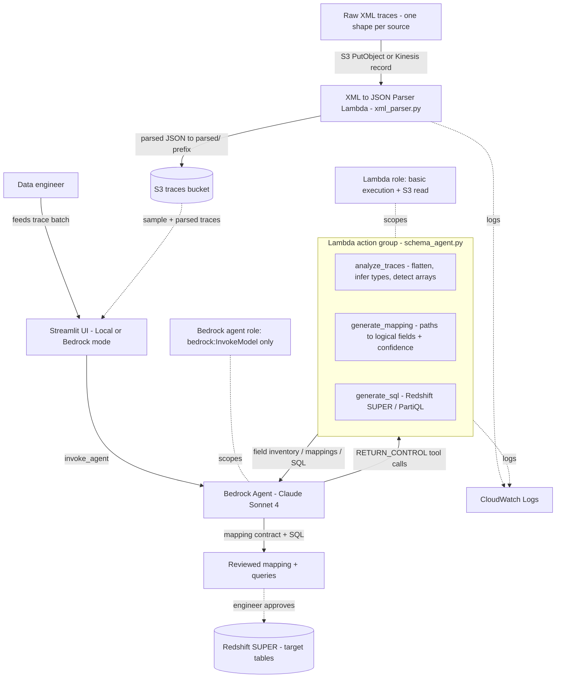

# Architecture — XML Schema Inference Agent

This is a **single-agent, tool-using pattern**: one Bedrock Agent (Claude Sonnet 4) with a three-tool Lambda action group, fed by a separate XML→JSON parser Lambda and backed by S3 for trace storage. The agent does the reasoning (which tool to call, how to interpret results, how to unify across sources); the tools do the deterministic work (flatten, type-infer, detect arrays, score mappings, build SQL). The output is a field-mapping contract plus Redshift SUPER/PartiQL queries — reviewed by a data engineer before anything reaches production.

## Stack diagram

Deploy path: `cd src/cdk && cdk deploy` provisions the **S3** traces bucket (with sample data uploaded), the tools **Lambda**, the Lambda execution role, and the **Bedrock agent role** with a scoped `bedrock:InvokeModel` policy. The Bedrock Agent itself and its action group are created (console or IaC) and pointed at the Lambda using `src/lambda/api_schema.json`.

## Component responsibilities

| Component | Responsibility | You customize |
|---|---|---|
| XML→JSON parser Lambda (`lambda/xml_parser.py`) | Convert raw nested XML to JSON; collapse repeating tags and `ArrayElementObject/String` into arrays; coarse type inference | Array idioms, `infer_type` rules per source |
| S3 traces bucket | Store raw + parsed traces (`parsed/` prefix); seed sample data | Bucket name, lifecycle, prefixes |
| Bedrock Agent (Claude Sonnet 4) | Orchestrate the three tools, interpret results, unify fields across sources | System prompt (`hackathon/agent_prompt.md`) |
| `analyze_traces` tool | Flatten JSON to a field inventory; infer types; detect arrays across a batch | Type rules in `infer_type` |
| `generate_mapping` tool | Map discovered paths → `STANDARD_FIELDS` with confidence; report unmapped/ambiguous | `STANDARD_FIELDS`, `PATH_PATTERNS` |
| `generate_sql` tool | Build Redshift SUPER/PartiQL SELECT + view + sample analytics from mappings | Table name, view naming, PartiQL paths |
| Streamlit UI (`src/ui/app.py`) | Demo surface; Local mode runs tools directly, Bedrock mode streams reasoning | Branding, demo flow |
| IAM roles | Least-privilege agent role (`bedrock:InvokeModel`) and Lambda role (basic exec + S3 read) | Account, region, naming |

## Design decisions (summary)

Full rationale is in [`build-spec/architecture-decisions.md`](../build-spec/architecture-decisions.md). Highlights: a single agent with deterministic tools (not a free-form prompt) so output is reproducible and reviewable; schema-level array detection across a trace batch (the failure mode that broke prior lake-house POCs); confidence scores + unmapped-field reporting as first-class output; the standard-field catalog kept in sync between prompt and tool code; and human review before any mapping reaches production.

## Data flow — happy path

1. Raw XML for a source lands in S3 (or arrives on a Kinesis stream); the parser Lambda converts it to JSON under the `parsed/` prefix.
2. A data engineer (or the Streamlit UI) feeds a batch of parsed traces for one source to the Bedrock Agent with a customer identifier.
3. The agent calls **`analyze_traces`**: the tool flattens every trace, infers a type per field from its string value, detects repeating elements as arrays across the batch, and returns a deduplicated field inventory with sample values.
4. The agent calls **`generate_mapping`** with that inventory: the tool matches each path against `PATH_PATTERNS` first (nested cases), then `STANDARD_FIELDS` keywords, scoring each mapping and keeping the highest-confidence candidate per logical field.
5. The tool returns mappings with confidence plus `unmapped_fields` and any ambiguous matches.
6. The agent calls **`generate_sql`**: the tool converts each mapped path to a PartiQL accessor and emits a SELECT, a `CREATE VIEW`, and 2–3 sample analytics queries against the Redshift SUPER table.
7. The agent assembles the field inventory, the mapping contract, and the SQL into a single response.
8. For a second, structurally different source, steps 2–7 repeat with no code change; the agent produces a **unified mapping** showing the same logical field at different physical paths per source.
9. A data engineer reviews mappings and confidence, corrects anything flagged, and approves.
10. Approved SQL/views are applied to your Redshift SUPER tables; the mapping is recorded for reuse.

## Data flow — alternate paths

- **Local mode (no AWS):** the Streamlit UI imports and runs the three tool functions directly, so the discovery→map→SQL flow is demonstrable with zero credentials — used for the demo and for tests (`src/lambda/test_local.py`).
- **Kinesis ingestion:** instead of S3 PutObject, the parser Lambda also accepts Kinesis records (base64-decoded XML) for streaming trace ingestion.
- **Low-confidence / unmapped:** fields the tool can't confidently map are returned in `unmapped_fields` rather than guessed, routing them to human review.

## Audit trail

- Each mapping carries a `confidence` score and its source `customer_path`, so any logical field can be traced back to the exact physical path it came from.
- `analyze_traces` returns the full field inventory and `arrays_detected`, giving a complete record of what was discovered per source.
- Lambda execution (both the parser and the tools) logs to **CloudWatch**; Bedrock agent invocation logging can be enabled for the model calls.

## What's NOT in this architecture (intentionally)

- **No autonomous write to production.** Generated SQL is reviewed and applied by an engineer; the agent never executes DDL/DML against live tables.
- **No persisted mapping registry.** The reference *returns* mappings; a durable, versioned registry (e.g. DynamoDB) is a production add-on, not shipped. The use-case doc shows it as an optional component.
- **No deployed Redshift cluster.** Redshift SUPER is the *target* the generated SQL is written for; standing up Redshift Serverless and running the queries is your step, optional for the demo.
- **No authentication layer** on the demo Streamlit UI — a production surface must add auth and run inside your network boundary.
